## NAMA  : NEVITA TRIYA YULIANA <br>
## KELAS : TI-3F <br>
## ABSEN : 20 <br>


# Navigation & State Management

<details>
<summary><h3>2. Konsep navigasi dan GoRouter</h3></summary>
<br>
<blockquote>

## flutter pub add go_route
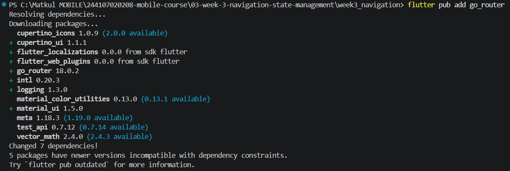<br>
## Susun struktur folder:<br>
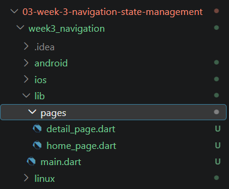<br>
## 1. Definisikan router di lib/main.dart:<br>
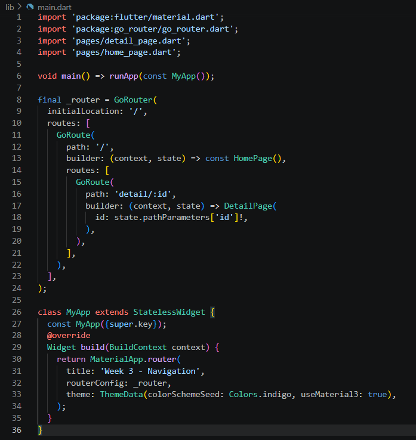<br>
## 2. Halaman Home (lib/pages/home_page.dart):<br>
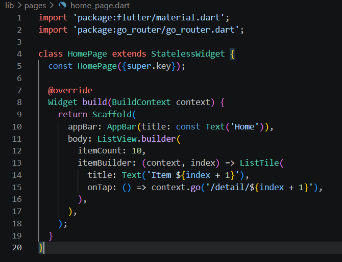<br>
## 3. Halaman Detail (lib/pages/detail_page.dart)<br>
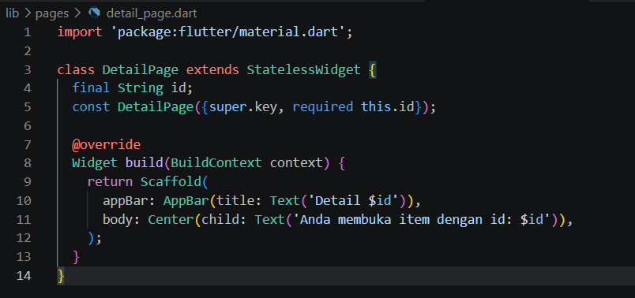<br>
## 4. Jalankan dan amati. Buka item, lalu tekan tombol back sistem. Perhatikan bahwa path berubah mengikuti layar aktif, path yang sama juga dapat diakses langsung tanpa melewati Home. Inilah keunggulan router deklaratif dibanding Navigator 1.0.<br>
| Tampilan hasil run | Tampilan Detail |
|---|---|
| 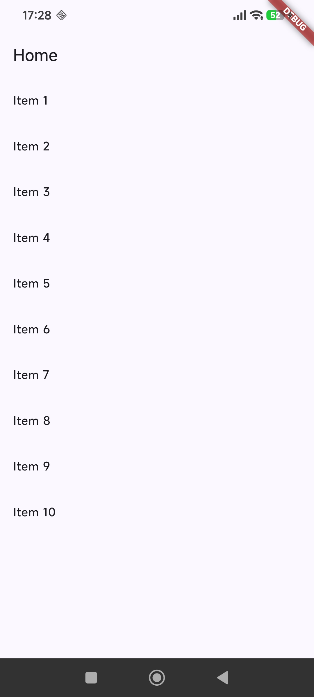 | 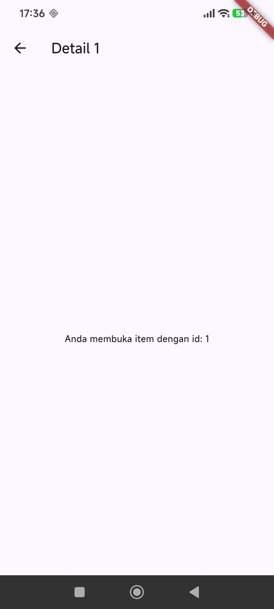 |
</blockquote>
</details>

<br>

<details>
<summary><h3>3. State management dengan Riverpod</h3></summary>
<br>
<blockquote>

## flutter pub add flutter_riverpod
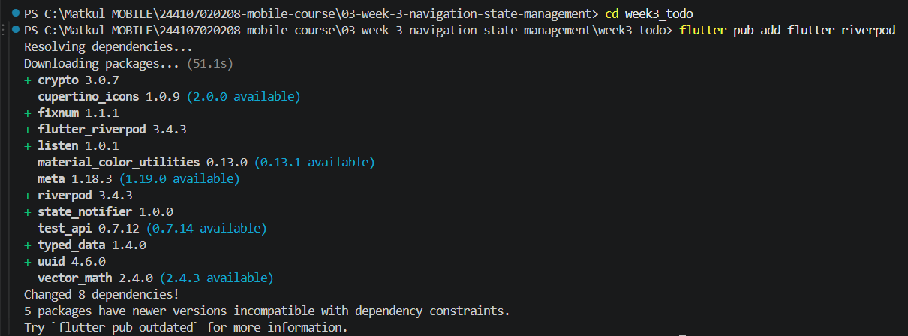<br>
## 1. Bungkus aplikasi dengan ProviderScope di lib/main.dart:<br>
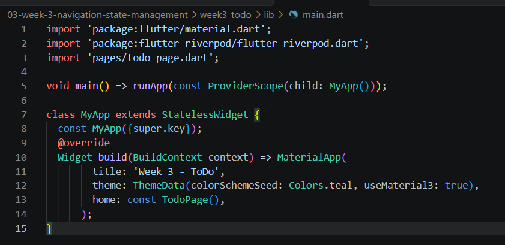<br>
## 2. Buat state dan provider (lib/providers/todo_provider.dart):<br>
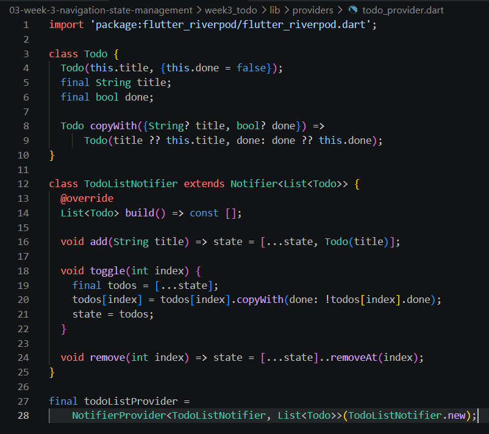<br>
## 3. Tampilkan dengan ConsumerWidget (lib/pages/todo_page.dart):<br>
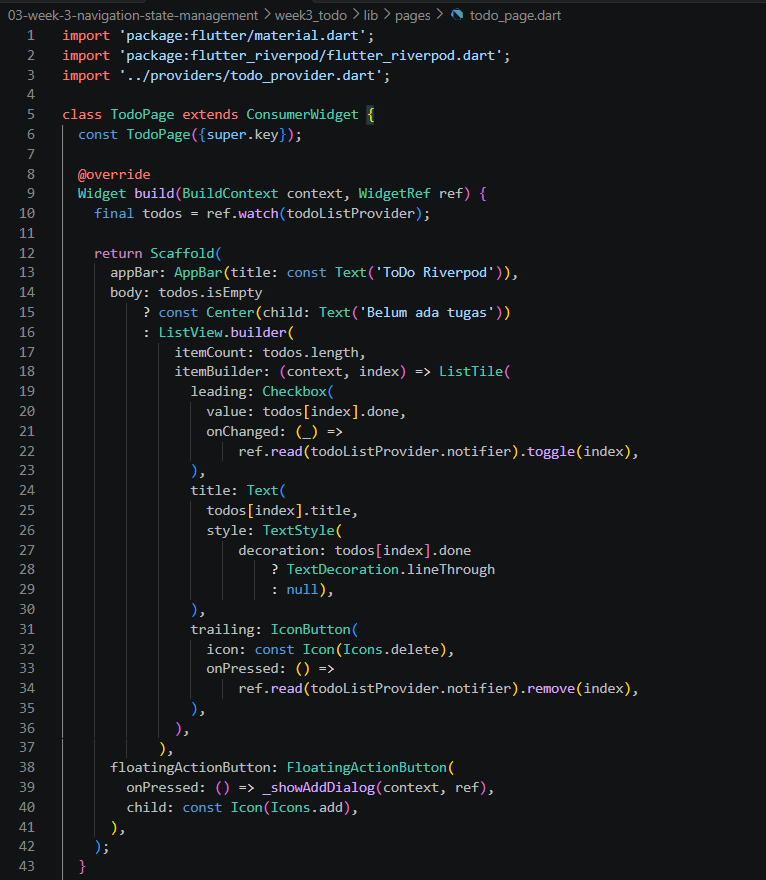<br>
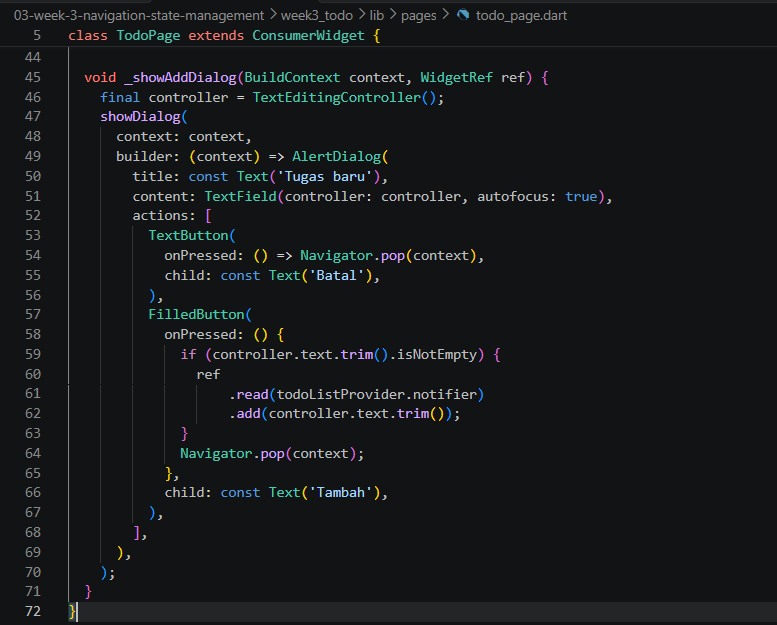<br>
## 4. Hasil Run<br>
| Tampilan hasil run | Tampilan Tambah |
|---|---|
| 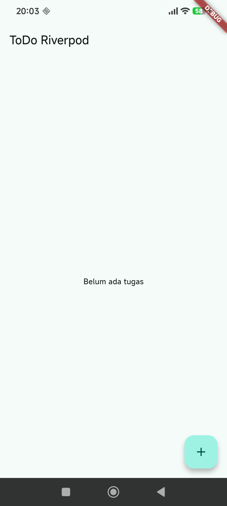 | 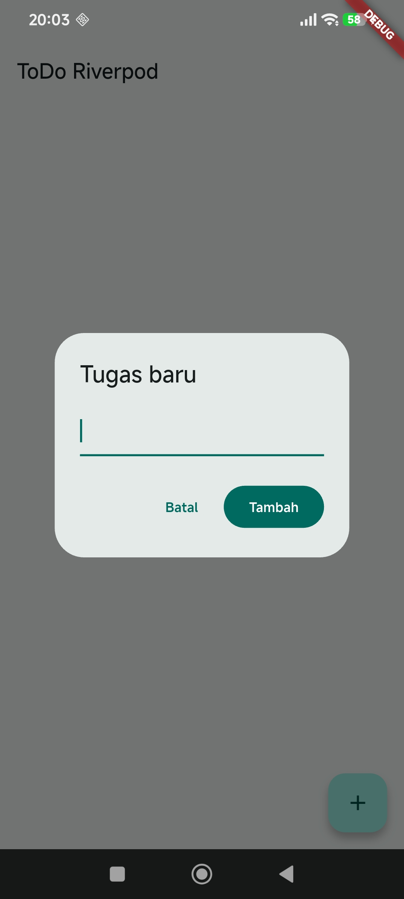 |

<br>

| Tampilan Sudah Selesai/Dicentang | Tampilan Hapus |
|---|---|
| 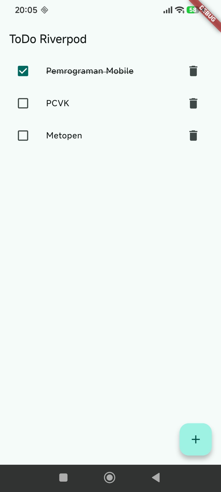 | 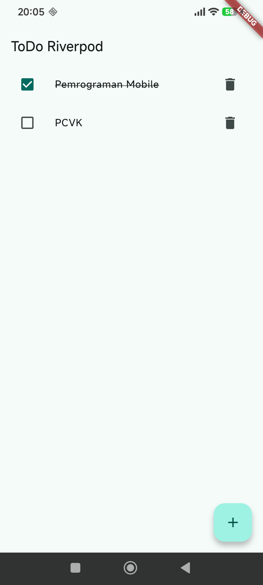 |
</blockquote>
</details>

<br>

<details>
<summary><h3>4. AsyncValue: loading, error, success</h3></summary>
<br>
<blockquote>

## main.dart (week3_todo)
```dart
import 'package:flutter/material.dart';
import 'package:flutter_riverpod/flutter_riverpod.dart';
import 'pages/product_page.dart';

void main() => runApp(const ProviderScope(child: MyApp()));

class MyApp extends StatelessWidget {
  const MyApp({super.key});
  @override
  Widget build(BuildContext context) => MaterialApp(
        title: 'Week 3 - Produk',
        theme: ThemeData(colorSchemeSeed: Colors.teal, useMaterial3: true),
        home: const ProductPage(),
      );
}
```
## product_page(week3_todo)
```dart
import 'package:flutter/material.dart';
import 'package:flutter_riverpod/flutter_riverpod.dart';
import '../providers/products_provider.dart';

class ProductPage extends ConsumerWidget {
  const ProductPage({super.key});

  @override
  Widget build(BuildContext context, WidgetRef ref) {
    final productsAsync = ref.watch(productsProvider);

    return Scaffold(
      appBar: AppBar(title: const Text('Produk')),
      body: productsAsync.when(
        loading: () => const Center(child: CircularProgressIndicator()),
        error: (err, stack) => Center(
          child: Column(
            mainAxisSize: MainAxisSize.min,
            children: [
              Text('Gagal memuat: $err'),
              FilledButton(
                onPressed: () => ref.invalidate(productsProvider),
                child: const Text('Coba lagi'),
              ),
            ],
          ),
        ),
        data: (products) => ListView.builder(
          itemCount: products.length,
          itemBuilder: (context, index) =>
              ListTile(title: Text(products[index])),
        ),
      ),
    );
  }
}
```
## products_provider(week3_todo)
```dart
import 'package:flutter_riverpod/flutter_riverpod.dart';

class ProductsNotifier extends AsyncNotifier<List<String>> {
  @override
  Future<List<String>> build() async {
    await Future.delayed(const Duration(seconds: 2)); // simulasi network
    return ['Keyboard', 'Mouse', 'Monitor'];
  }

  Future<void> refresh() async {
    state = const AsyncLoading();
    state = await AsyncValue.guard(() => _fetch());
  }

  Future<List<String>> _fetch() async {
    await Future.delayed(const Duration(seconds: 1));
    return ['Keyboard', 'Mouse', 'Monitor', 'Headset'];
  }
}

final productsProvider =
    AsyncNotifierProvider<ProductsNotifier, List<String>>(
        ProductsNotifier.new);
```

## Hasil Run nomor 1<br>
| Tampilan hasil run | 
|---|
| | 

## Uji state error pada nomor 2 modul
### products_provider
```dart
import 'package:flutter_riverpod/flutter_riverpod.dart';

class ProductsNotifier extends AsyncNotifier<List<String>> {
  @override
  Future<List<String>> build() async {
    await Future.delayed(const Duration(seconds: 2));
    throw Exception('Gagal terhubung ke server');
  }

  Future<void> refresh() async {
    state = const AsyncLoading();
    state = await AsyncValue.guard(() => _fetch());
  }

  Future<List<String>> _fetch() async {
    await Future.delayed(const Duration(seconds: 1));
    return ['Keyboard', 'Mouse', 'Monitor', 'Headset'];
  }
}

final productsProvider =
    AsyncNotifierProvider<ProductsNotifier, List<String>>(
        ProductsNotifier.new);
```
### hasil run nomor 2
| Tampilan Loading | Tampilan Gagal |
|---|---|
| 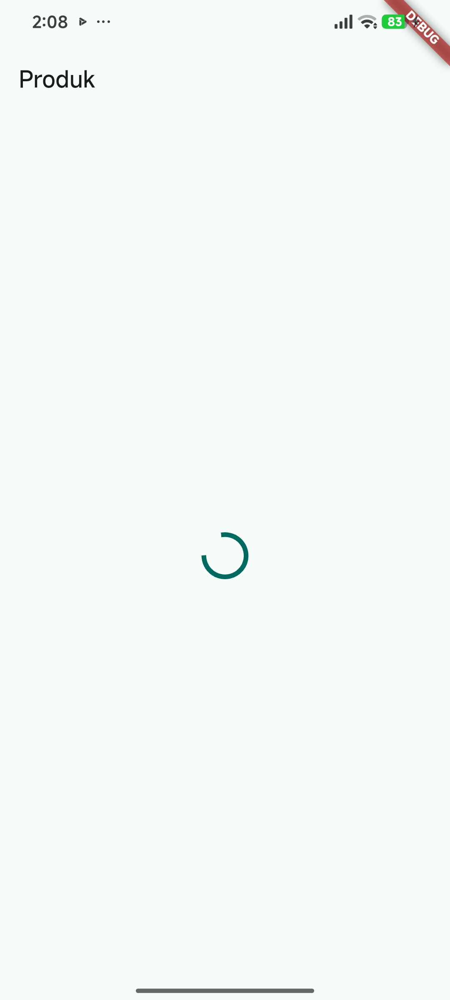 | 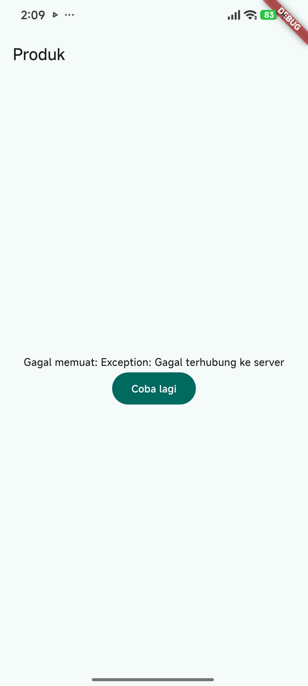 |

## Tombol Coba lagi dan pemulihan pada nomor 3
### products.provider
```dart
import 'package:flutter_riverpod/flutter_riverpod.dart';

class ProductsNotifier extends AsyncNotifier<List<String>> {
  @override
    Future<List<String>> build() async {
    await Future.delayed(const Duration(seconds: 2));
    return ['Keyboard', 'Mouse', 'Monitor'];
}

  Future<void> refresh() async {
    state = const AsyncLoading();
    state = await AsyncValue.guard(() => _fetch());
  }

  Future<List<String>> _fetch() async {
    await Future.delayed(const Duration(seconds: 1));
    return ['Keyboard', 'Mouse', 'Monitor', 'Headset'];
  }
}

final productsProvider =
    AsyncNotifierProvider<ProductsNotifier, List<String>>(
        ProductsNotifier.new);
```
### hasil run nomor 3
| Tampilan setelah klik coba lagi| 
|---|
|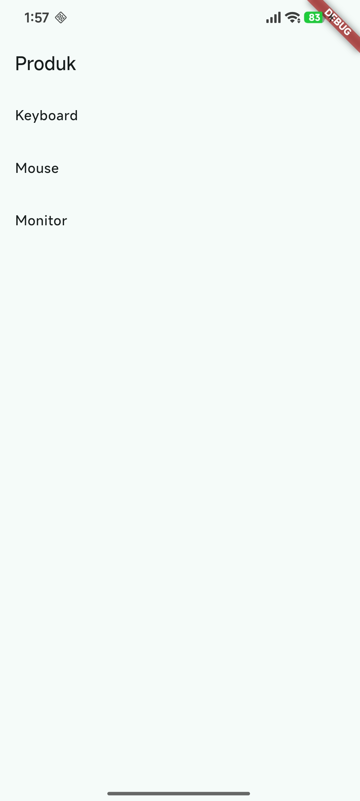 | 

## refleksi pada poin nomor 4 
**Mengapa menampilkan data lama dengan indikator refresh kadang lebih baik daripada mengosongkan layar?** <br>
- Pengguna tidak kehilangan konteks: daftar yang sedang dibaca tidak tiba-tiba hilang.<br>
- Data lama biasanya masih berguna selagi data baru dimuat.<br>
- Aplikasi terasa lebih cepat dan tidak berkedip. <br>
- Jika refresh gagal, data lama masih bisa ditampilkan dengan pesan error kecil, bukan layar kosong. <br>

</blockquote>
</details>

<br>

<details>
<summary><h3>6. Refactoring dan testing</h3></summary>
<br>
<blockquote>

## 1. Refactor TodoTile
### 1a. Ganti lib/providers/todo_provider.dart
``` dart
import 'package:flutter_riverpod/flutter_riverpod.dart';

class Todo {
  const Todo({required this.id, required this.title, this.done = false});
  final int id;
  final String title;
  final bool done;

  Todo copyWith({String? title, bool? done}) =>
      Todo(id: id, title: title ?? this.title, done: done ?? this.done);
}

class TodoListNotifier extends Notifier<List<Todo>> {
  int _nextId = 0;

  @override
  List<Todo> build() => const [];

  void add(String title) =>
      state = [...state, Todo(id: _nextId++, title: title)];

  void toggle(int id) => state = [
        for (final t in state)
          if (t.id == id) t.copyWith(done: !t.done) else t,
      ];

  void remove(int id) => state = state.where((t) => t.id != id).toList();
}

final todoListProvider =
    NotifierProvider<TodoListNotifier, List<Todo>>(TodoListNotifier.new);
```
### 1b. Buat folder dan file widget<br>
#### todo_tile.dart
``` dart
import 'package:flutter/material.dart';
import '../providers/todo_provider.dart';

class TodoTile extends StatelessWidget {
  const TodoTile({
    super.key,
    required this.todo,
    required this.onToggle,
    required this.onDelete,
  });

  final Todo todo;
  final VoidCallback onToggle;
  final VoidCallback onDelete;

  @override
  Widget build(BuildContext context) {
    return ListTile(
      onTap: onToggle,
      leading: Checkbox(value: todo.done, onChanged: (_) => onToggle()),
      title: Text(
        todo.title,
        style: TextStyle(
          decoration: todo.done ? TextDecoration.lineThrough : null,
        ),
      ),
      trailing: IconButton(
        icon: const Icon(Icons.delete),
        tooltip: 'Hapus',
        onPressed: onDelete,
      ),
    );
  }
}
```
#### add_todo_dialog.dart
``` dart
import 'package:flutter/material.dart';

class AddTodoDialog extends StatefulWidget {
  const AddTodoDialog({super.key});

  @override
  State<AddTodoDialog> createState() => _AddTodoDialogState();
}

class _AddTodoDialogState extends State<AddTodoDialog> {
  final _controller = TextEditingController();

  @override
  void dispose() {
    _controller.dispose();
    super.dispose();
  }

  @override
  Widget build(BuildContext context) {
    return AlertDialog(
      title: const Text('Tugas baru'),
      content: TextField(controller: _controller, autofocus: true),
      actions: [
        TextButton(
          onPressed: () => Navigator.pop(context),
          child: const Text('Batal'),
        ),
        FilledButton(
          onPressed: () => Navigator.pop(context, _controller.text.trim()),
          child: const Text('Tambah'),
        ),
      ],
    );
  }
}
```
### 1c. Ganti lib/pages/todo_page.dart
``` dart
import 'package:flutter/material.dart';
import 'package:flutter_riverpod/flutter_riverpod.dart';
import '../providers/todo_provider.dart';
import '../widgets/add_todo_dialog.dart';
import '../widgets/todo_tile.dart';

class TodoPage extends ConsumerWidget {
  const TodoPage({super.key});

  Future<void> _addTodo(BuildContext context, WidgetRef ref) async {
    final title = await showDialog<String>(
      context: context,
      builder: (_) => const AddTodoDialog(),
    );
    if (title != null && title.isNotEmpty) {
      ref.read(todoListProvider.notifier).add(title);
    }
  }

  @override
  Widget build(BuildContext context, WidgetRef ref) {
    final todos = ref.watch(todoListProvider);
    final notifier = ref.read(todoListProvider.notifier);

    return Scaffold(
      appBar: AppBar(title: const Text('ToDo Riverpod')),
      body: todos.isEmpty
          ? const Center(child: Text('Belum ada tugas'))
          : ListView.builder(
              itemCount: todos.length,
              itemBuilder: (context, i) {
                final todo = todos[i];
                return TodoTile(
                  key: ValueKey(todo.id),
                  todo: todo,
                  onToggle: () => notifier.toggle(todo.id),
                  onDelete: () => notifier.remove(todo.id),
                );
              },
            ),
      floatingActionButton: FloatingActionButton(
        onPressed: () => _addTodo(context, ref),
        child: const Icon(Icons.add),
      ),
    );
  }
}
```
## hasil run
| Tampilan run| 
|---|
|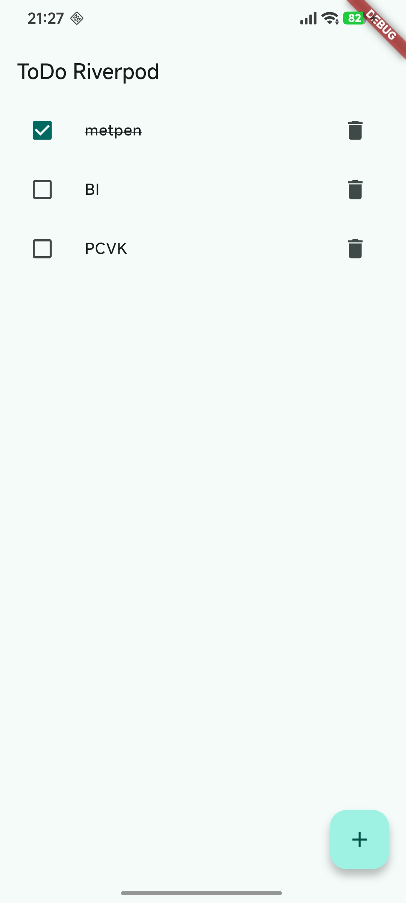 | 

## 2. Provider turunan untuk filter
### lib/providers/todo_derived_providers.dart
``` dart
import 'package:flutter_riverpod/flutter_riverpod.dart';
import 'todo_provider.dart';

enum TodoFilter { all, active, completed }

class TodoFilterNotifier extends Notifier<TodoFilter> {
  @override
  TodoFilter build() => TodoFilter.all;

  void set(TodoFilter filter) => state = filter;
}

final todoFilterProvider =
    NotifierProvider<TodoFilterNotifier, TodoFilter>(TodoFilterNotifier.new);

/// Provider turunan: membaca todoListProvider dan todoFilterProvider.
final filteredTodosProvider = Provider<List<Todo>>((ref) {
  final todos = ref.watch(todoListProvider);
  final filter = ref.watch(todoFilterProvider);
  return switch (filter) {
    TodoFilter.all => todos,
    TodoFilter.active => todos.where((t) => !t.done).toList(),
    TodoFilter.completed => todos.where((t) => t.done).toList(),
  };
});
```
### Ganti lagi lib/pages/todo_page.dart<br>
```dart
import 'package:flutter/material.dart';
import 'package:flutter_riverpod/flutter_riverpod.dart';
import '../providers/todo_derived_providers.dart';
import '../providers/todo_provider.dart';
import '../widgets/add_todo_dialog.dart';
import '../widgets/todo_tile.dart';

class TodoPage extends ConsumerWidget {
  const TodoPage({super.key});

  Future<void> _addTodo(BuildContext context, WidgetRef ref) async {
    final title = await showDialog<String>(
      context: context,
      builder: (_) => const AddTodoDialog(),
    );
    if (title != null && title.isNotEmpty) {
      ref.read(todoListProvider.notifier).add(title);
    }
  }

  @override
  Widget build(BuildContext context, WidgetRef ref) {
    return Scaffold(
      appBar: AppBar(title: const Text('ToDo Riverpod')),
      body: const Column(
        children: [
          _FilterBar(),
          Expanded(child: _TodoList()),
        ],
      ),
      floatingActionButton: FloatingActionButton(
        onPressed: () => _addTodo(context, ref),
        child: const Icon(Icons.add),
      ),
    );
  }
}

class _FilterBar extends ConsumerWidget {
  const _FilterBar();

  @override
  Widget build(BuildContext context, WidgetRef ref) {
    final filter = ref.watch(todoFilterProvider);
    return Padding(
      padding: const EdgeInsets.all(12),
      child: SegmentedButton<TodoFilter>(
        showSelectedIcon: false,
        segments: const [
          ButtonSegment(value: TodoFilter.all, label: Text('Semua')),
          ButtonSegment(value: TodoFilter.active, label: Text('Belum selesai')),
          ButtonSegment(value: TodoFilter.completed, label: Text('Selesai')),
        ],
        selected: {filter},
        onSelectionChanged: (s) =>
            ref.read(todoFilterProvider.notifier).set(s.first),
      ),
    );
  }
}

class _TodoList extends ConsumerWidget {
  const _TodoList();

  @override
  Widget build(BuildContext context, WidgetRef ref) {
    final all = ref.watch(todoListProvider);
    final visible = ref.watch(filteredTodosProvider);

    if (all.isEmpty) {
      return const Center(child: Text('Belum ada tugas'));
    }
    if (visible.isEmpty) {
      return const Center(child: Text('Tidak ada tugas pada filter ini'));
    }

    final notifier = ref.read(todoListProvider.notifier);
    return ListView.builder(
      itemCount: visible.length,
      itemBuilder: (context, i) {
        final todo = visible[i];
        return TodoTile(
          key: ValueKey(todo.id),
          todo: todo,
          onToggle: () => notifier.toggle(todo.id),
          onDelete: () => notifier.remove(todo.id),
        );
      },
    );
  }
}
```
## hasil run
| Tampilan semua | Tampilan Belum Selesai | Tampilan Selesai |
|---|---|---|
|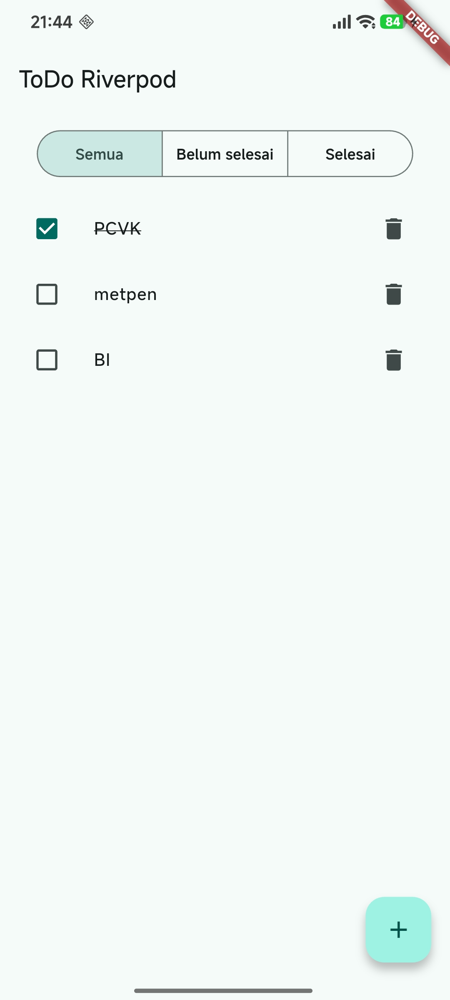 |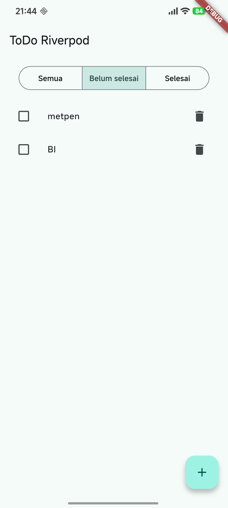 |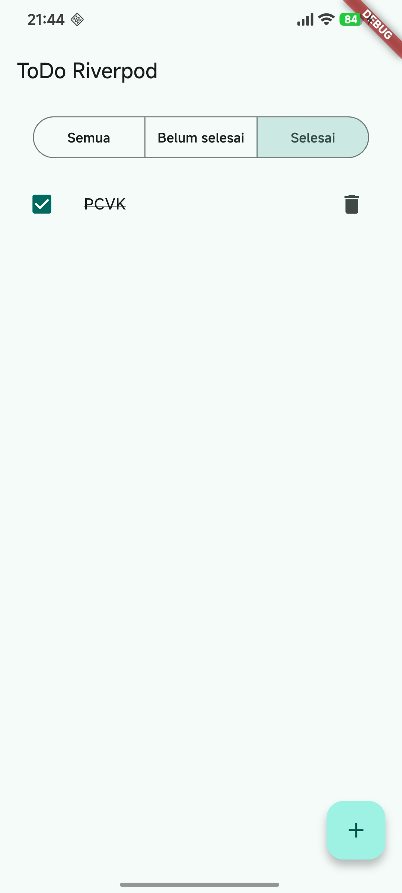
## 3. GoRouter dan NavigationBar
### lib/pages/scaffold_with_nav_bar.dart
```dart
import 'package:flutter/material.dart';
import 'package:go_router/go_router.dart';

class ScaffoldWithNavBar extends StatelessWidget {
  const ScaffoldWithNavBar({super.key, required this.navigationShell});
  final StatefulNavigationShell navigationShell;

  @override
  Widget build(BuildContext context) {
    return Scaffold(
      body: navigationShell,
      bottomNavigationBar: NavigationBar(
        selectedIndex: navigationShell.currentIndex,
        onDestinationSelected: (index) => navigationShell.goBranch(
          index,
          initialLocation: index == navigationShell.currentIndex,
        ),
        destinations: const [
          NavigationDestination(icon: Icon(Icons.checklist), label: 'Tugas'),
          NavigationDestination(icon: Icon(Icons.bar_chart), label: 'Statistik'),
        ],
      ),
    );
  }
}
```
### lib/router.dart
``` dart
import 'package:flutter_riverpod/flutter_riverpod.dart';
import 'package:go_router/go_router.dart';
import 'pages/scaffold_with_nav_bar.dart';
import 'pages/stats_page.dart';
import 'pages/todo_page.dart';

final routerProvider = Provider<GoRouter>((ref) {
  return GoRouter(
    initialLocation: '/',
    routes: [
      StatefulShellRoute.indexedStack(
        builder: (context, state, navigationShell) =>
            ScaffoldWithNavBar(navigationShell: navigationShell),
        branches: [
          StatefulShellBranch(routes: [
            GoRoute(
              path: '/',
              builder: (context, state) => const TodoPage(),
            ),
          ]),
          StatefulShellBranch(routes: [
            GoRoute(
              path: '/stats',
              builder: (context, state) => const StatsPage(),
            ),
          ]),
        ],
      ),
    ],
  );
});
```
### Ganti lib/main.dart
```dart
import 'package:flutter/material.dart';
import 'package:flutter_riverpod/flutter_riverpod.dart';
import 'router.dart';

void main() => runApp(const ProviderScope(child: MyApp()));

class MyApp extends ConsumerWidget {
  const MyApp({super.key});

  @override
  Widget build(BuildContext context, WidgetRef ref) {
    return MaterialApp.router(
      title: 'Week 3 - ToDo',
      routerConfig: ref.watch(routerProvider),
      theme: ThemeData(colorSchemeSeed: Colors.teal, useMaterial3: true),
    );
  }
}
```
## hasil run
| Tampilan Todo Riverpod | Tampilan Statistik |
|---|---|
| 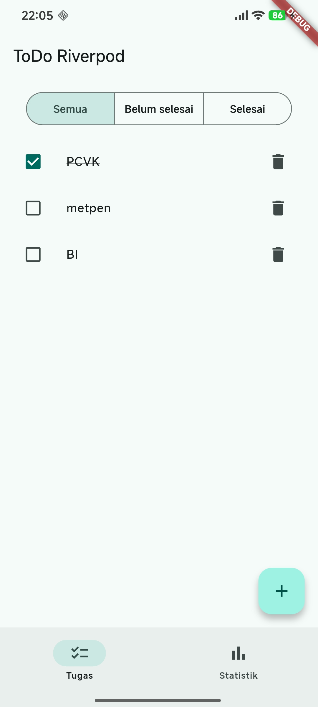 | 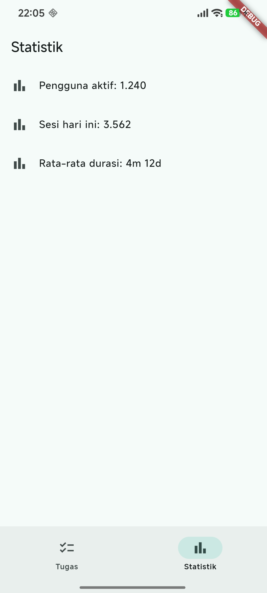 |

## 4. Testing
### Ganti test/widget_test.dart
```dart
import 'package:flutter/material.dart';
import 'package:flutter_riverpod/flutter_riverpod.dart';
import 'package:flutter_test/flutter_test.dart';
import 'package:week3_todo/main.dart';
import 'package:week3_todo/pages/stats_page.dart';

Future<void> _addTodo(WidgetTester tester, String title) async {
  await tester.tap(find.byIcon(Icons.add));
  await tester.pumpAndSettle();
  await tester.enterText(find.byType(TextField), title);
  await tester.tap(find.text('Tambah'));
  await tester.pumpAndSettle(); // tunggu dialog selesai tertutup
}


Duration? _noRetry(int retryCount, Object error) => null;

void main() {
  testWidgets('menambah tugas baru', (tester) async {
    await tester.pumpWidget(const ProviderScope(child: MyApp()));
    expect(find.text('Belum ada tugas'), findsOneWidget);

    await _addTodo(tester, 'Kerjakan PR minggu 3');

    expect(find.text('Kerjakan PR minggu 3'), findsOneWidget);
  });

  testWidgets('state ToDo bertahan saat pindah halaman', (tester) async {
    await tester.pumpWidget(
      const ProviderScope(retry: _noRetry, child: MyApp()),
    );
    await _addTodo(tester, 'Belajar GoRouter');

    final nav = find.byType(NavigationBar);

    await tester.tap(find.descendant(of: nav, matching: find.text('Statistik')));
    // Jangan pumpAndSettle: StatsPage punya spinner dan delay 2 detik.
    await tester.pump(); // bangun StatsPage dulu, timer 2 detik mulai di sini
    await tester.pump(const Duration(seconds: 3)); // lalu majukan waktu
    expect(find.byType(StatsPage), findsOneWidget);

    await tester.tap(find.descendant(of: nav, matching: find.text('Tugas')));
    await tester.pumpAndSettle();
    expect(find.text('Belajar GoRouter'), findsOneWidget);
  });

  testWidgets('filter Belum selesai menyembunyikan tugas selesai',
      (tester) async {
    await tester.pumpWidget(const ProviderScope(child: MyApp()));
    await _addTodo(tester, 'Tugas A');

    await tester.tap(find.byType(Checkbox));
    await tester.pump();
    await tester.tap(find.text('Belum selesai'));
    await tester.pumpAndSettle();

    expect(find.text('Tugas A'), findsNothing);
    expect(find.text('Tidak ada tugas pada filter ini'), findsOneWidget);
  });
}
```
### test/todo_tile_test.dart
```dart
import 'package:flutter/material.dart';
import 'package:flutter_test/flutter_test.dart';
import 'package:week3_todo/providers/todo_provider.dart';
import 'package:week3_todo/widgets/todo_tile.dart';

void main() {
  testWidgets('TodoTile memanggil callback toggle dan delete', (tester) async {
    var toggled = 0, deleted = 0;
    await tester.pumpWidget(MaterialApp(
      home: Scaffold(
        body: TodoTile(
          todo: const Todo(id: 1, title: 'Uji tile'),
          onToggle: () => toggled++,
          onDelete: () => deleted++,
        ),
      ),
    ));

    await tester.tap(find.byType(Checkbox));
    await tester.tap(find.byIcon(Icons.delete));

    expect(toggled, 1);
    expect(deleted, 1);
  });
}
```
### todo_providers_test.dart
``` dart
import 'package:flutter_riverpod/flutter_riverpod.dart';
import 'package:flutter_test/flutter_test.dart';
import 'package:week3_todo/providers/todo_derived_providers.dart';
import 'package:week3_todo/providers/todo_provider.dart';

void main() {
  test('filteredTodosProvider mengikuti filter', () {
    final container = ProviderContainer();
    addTearDown(container.dispose);

    container.read(todoListProvider.notifier)
      ..add('A')
      ..add('B')
      ..toggle(0); // A selesai

    final filter = container.read(todoFilterProvider.notifier);

    filter.set(TodoFilter.active);
    expect(container.read(filteredTodosProvider).map((t) => t.title), ['B']);

    filter.set(TodoFilter.completed);
    expect(container.read(filteredTodosProvider).map((t) => t.title), ['A']);

    filter.set(TodoFilter.all);
    expect(container.read(filteredTodosProvider).length, 2);
  });
}
```
### hasil test
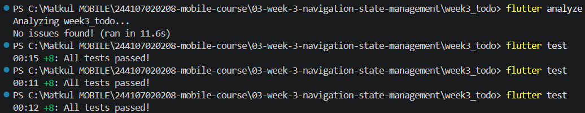
</blockquote>
</details>

<br>