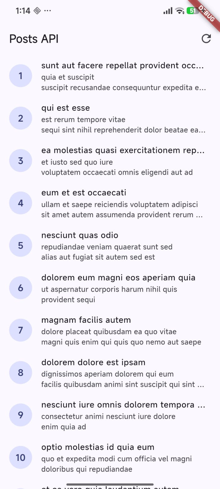
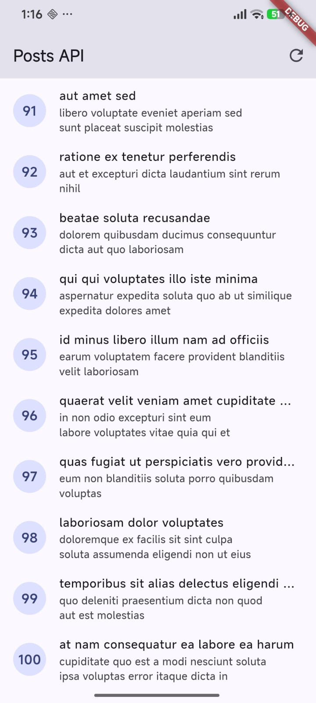
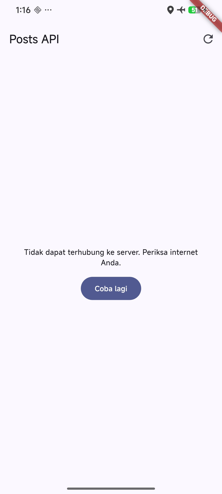
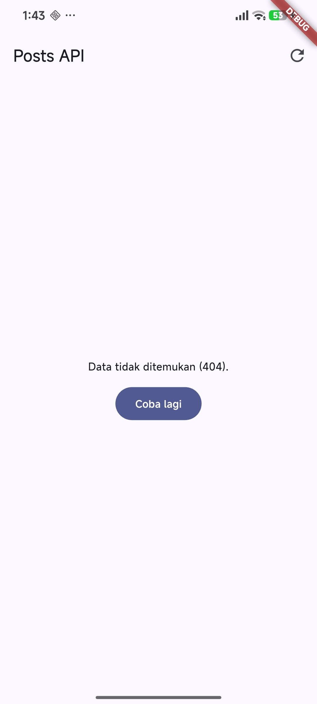
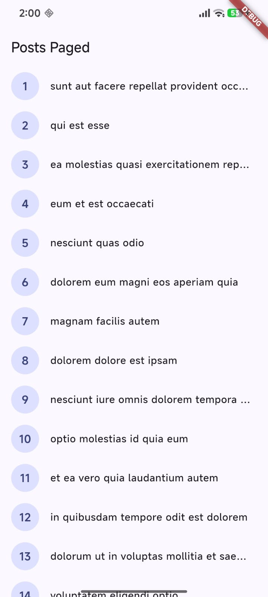
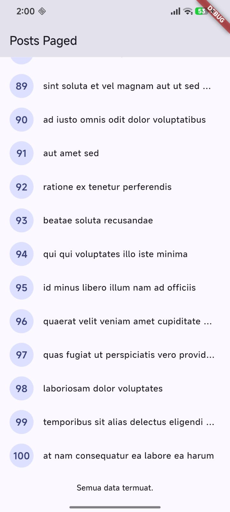
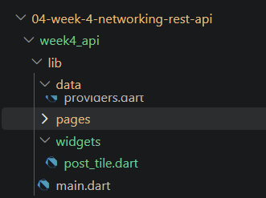
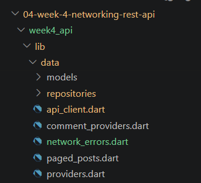
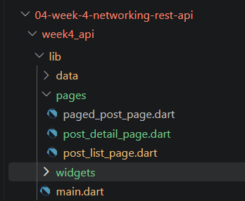

## NAMA  : NEVITA TRIYA YULIANA  
## KELAS : TI-3F  
## ABSEN : 20  

# Networking & REST API

<h3>Praktikum 1: Dio dan model data</h3>

 
<blockquote>

| Tampilan hasil run | 
|---|
|  | 
</blockquote>

 

<h3>Praktikum 2: Provider dan error handling</h3>

 
<blockquote>

| Tampilan hasil no 1-10 | Tampilan hasil 91-100 | 
|---|---|
|  | |

 

|Tampilan hasil mode pesawat |Tampilan hasil URL salah |
|---|---|
| |  |

</blockquote>

 

<h3>Praktikum 3: Pagination dasar</h3>

 
<blockquote>

| Tampilan hasil no 1-14 | Tampilan hasil 89-100 | 
|---|---|
|  | | 
</blockquote>

 

<h3>Refactoring dan testing</h3>

 
<blockquote>

## 1. Ekstrak widget baris post menjadi PostTile tersendiri agar ListView.builder pendek dan mudah diuji.
 

## 2. Pindahkan friendlyErrorMessage ke file lib/data/network_errors.dart agar bisa dipakai ulang halaman paged dan non-paged.

## 3. Tambahkan halaman detail post dengan GoRouter (/post/:id) yang menampilkan title dan body lengkap, state detail diambil dari list yang sudah dimuat atau via repository bila langsung dibuka.

</blockquote>

 

<h3>Refleksi</h3>

 
<blockquote>

### 1. Mengapa UI dilarang memanggil Dio langsung? Apa yang rusak jika aturan ini dilanggar?

**UI dilarang memanggil Dio langsung karena widget seharusnya hanya mengurus tampilan, sedangkan urusan jaringan ada di repository dan provider. Kalau dilanggar, ada beberapa hal yang rusak. Pertama, logika error dan retry tersebar di banyak widget, padahal sekarang `friendlyErrorMessage` cukup ada di satu tempat dan dipakai bersama. Kedua, widget tidak bisa dites tanpa jaringan: di `widget_test.dart` saya mengganti repository asli dengan `FakePostRepository` lewat `ProviderScope(overrides: ...)`, dan itu hanya mungkin karena UI tidak bergantung pada Dio. Ketiga, mengubah `baseUrl`, timeout, atau interceptor harus mengedit semua widget yang memanggil Dio, bukan satu `createDio()`.**

### 2. Kapan pagination client-side cukup, dan kapan harus mengandalkan pagination server (`_page`/`_limit`)?

**Pagination client-side cukup kalau datanya kecil dan semuanya sudah termuat sekaligus, misalnya puluhan sampai ratusan item yang jarang berubah, sehingga aplikasi tinggal memotong list untuk ditampilkan. Pagination server (`_page` dan `_limit`) dibutuhkan kalau datanya besar atau terus bertambah, karena memuat semuanya memboroskan bandwidth, memori, dan waktu tunggu awal. Di praktikum ini `fetchPostsPage` meminta 10 item per halaman, sehingga halaman pertama tampil cepat dan sisanya dimuat saat pengguna menggulir. Konsekuensinya, aplikasi perlu mengelola state halaman sendiri (`page`, `hasMore`, `isLoadingMore`) dan guard supaya request tidak terkirim ganda.**

### 3. Bagaimana exception repository berubah menjadi `AsyncError` tanpa try/catch di setiap widget? Kapan try/catch eksplisit tetap dibutuhkan?

**Di `PostListNotifier`, `build()` mengembalikan `Future<List<Post>>`. Kalau repository melempar exception, Riverpod menangkapnya dan mengubah state menjadi `AsyncError`, sehingga widget cukup memakai `.when(loading, error, data)` tanpa try/catch. Try/catch eksplisit tetap dibutuhkan ketika state diatur manual. Contohnya `refresh()`, yang mengubah state ke `AsyncLoading`, lalu `AsyncData` atau `AsyncError` secara sendiri. Contoh lain adalah `PagedPostsNotifier`, yang memakai `Notifier` biasa dengan state buatan sendiri. Di `loadNextPage()`, try/catch dipakai agar saat error data lama tetap dipertahankan dan hanya field `error` yang diisi. Yang tidak boleh adalah catch kosong, karena menelan error tanpa memberi tahu pengguna.**

### 4. Bagian mana dari hasil AI yang Anda perbaiki, dan mengapa?

**Ada tiga hal. Pertama, `widget_test.dart` gagal karena mencari teks "Posts API" yang sudah usang sejak halaman utama menjadi `PagedPostPage` ("Posts Paged"), dan `flutter test` memblokir HTTP sungguhan. Saya memperbaikinya dengan repository palsu dan menambah test state error. Kedua, test `comment_test.dart` dari AI hanya menguji satu kasus (map kosong), jadi saya menambah happy path, sebagian field hilang, `null` eksplisit, dan tipe data salah. Dari kasus terakhir saya belajar bahwa `fromJson` yang aman dari crash belum tentu benar: `postId: '5'` diam-diam menjadi `0`. Ketiga, timeout ganda: AI menambahkan `requestTimeout` di repository padahal client sudah punya timeout. Saya memusatkannya menjadi satu konstanta `apiTimeout` di `api_client.dart` supaya tidak bisa tidak sinkron.**

</blockquote>

 