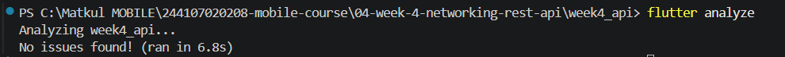
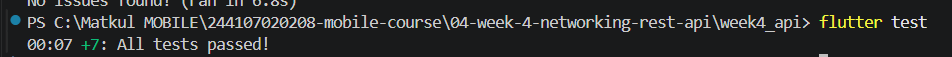

## 1. Prompt yang digunakan

### Prompt modul

Buatkan repository layer Flutter untuk endpoint GET /comments?postId={id}
dari JSONPlaceholder menggunakan Dio + flutter_riverpod.
Requirements:
- Model Comment dengan fromJson aman null (postId, id, name, email, body).
- CommentRepository dengan method fetchComments(postId) + timeout 10 detik.
- AsyncNotifierProvider dengan penanganan error otomatis (AsyncError)
  dan fungsi pesan error
  ramah pengguna untuk timeout, connection error, 404, dan 500.
- Satu unit test untuk fromJson dengan field yang hilang.
Jelaskan setiap bagian kode dalam komentar.

### Konteks proyek

- Gunakan createDio() dan dioProvider yang sudah ada; jangan membuat instance Dio baru.
- File baru: lib/data/models/comment.dart, lib/data/repositories/comment_repository.dart, lib/data/comment_providers.dart (provider + fungsi pesan error), test/comment_test.dart.
- Gaya Riverpod 3: AsyncNotifier dengan parameter lewat constructor dan AsyncNotifierProvider.family. Jangan pakai FamilyAsyncNotifier. Nonaktifkan retry otomatis dengan retry: (retryCount, error) => null.
- Timeout 10 detik berupa satu konstanta bernama di repository.
- Fungsi pesan error memetakan semua DioExceptionType (timeout, connectionError, badResponse 404 dan 500, tipe lain) ke Bahasa Indonesia, tanpa menampilkan exception mentah.
- Semua komentar dan pesan dalam Bahasa Indonesia. Tidak perlu UI, dan jangan ubah main.dart.

## 2. Output awal AI

Salinan output awal tersedia di folder [02-output-awal/](./02-output-awal/): [comment.dart](./02-output-awal/comment.dart), [comment_repository.dart](./02-output-awal/comment_repository.dart), [comment_providers.dart](./02-output-awal/comment_providers.dart), dan [comment_test.dart](./02-output-awal/comment_test.dart).

## 3. Verifikasi dan perbaikan

- [x] Apakah UI memanggil Dio langsung atau lewat repository?
  Temuan saya: Tidak. Alur data selalu UI → provider → repository → Dio. Provider di `comment_providers.dart` memanggil `ref.watch(commentRepositoryProvider).fetchComments(postId)`, dan Dio hanya dipakai di dalam `fetchComments` pada `comment_repository.dart`. Tidak ada widget di `lib/pages/` dan `lib/widgets/` yang memakai Dio langsung. Untuk Comment tidak ada UI karena prompt memang tidak memintanya.

- [x] Apakah fromJson aman null, atau masih memakai cast langsung yang bisa crash?
  Temuan saya: Aman dari crash. Setiap field diperiksa tipenya sebelum dipakai dan diberi nilai bawaan di `Comment.fromJson` (`comment.dart`), misalnya `json['postId'] is num ? ... : 0` dan `json['name'] is String ? ... : ''`. Catatan: "aman" tidak sama dengan "benar". Nilai bertipe salah, seperti `postId` berupa string `"5"`, diam-diam menjadi `0` dan datanya hilang tanpa error.

- [x] Apakah semua tipe DioExceptionType dipetakan ke pesan pengguna?
  Temuan saya: Ya. Fungsi pesan error di `comment_providers.dart` memakai switch yang menangani timeout, connectionError, badResponse, cancel, badCertificate, transformTimeout, dan unknown. Status 404 dan 500 punya pesan khusus, status badResponse lain memakai pesan umum. Tidak ada pesan exception mentah yang diteruskan ke pengguna.

- [x] Apakah baseUrl dan timeout terpusat di satu client, bukan tersebar di tiap method?
  Temuan saya: Awalnya belum. Output awal AI menambahkan `requestTimeout` sendiri di `comment_repository.dart` selain timeout di client, sehingga timeout didefinisikan di dua tempat dan bisa tidak sinkron. Sekarang timeout terpusat: `api_client.dart` mendefinisikan satu konstanta `apiTimeout` (10 detik) yang dipakai untuk `connectTimeout` dan `receiveTimeout`, dan repository tidak lagi punya timeout sendiri.

- [x] Apakah test benar-benar menguji field yang hilang, atau hanya happy path?
  Temuan saya: Test awal AI hanya satu kasus, yaitu map kosong (`02-output-awal/comment_test.dart`), sehingga sebagian field hilang, `null` eksplisit, dan tipe salah tidak teruji. Test saya sekarang menambah happy path, sebagian field hilang, `null` eksplisit, dan tipe salah di `test/comment_test.dart` (total 5 test).

- [x] Apakah flutter analyze dan flutter test lolos tanpa warning?
  Temuan saya: Hasil awal: analyze bersih, tetapi test gagal (`widget_test.dart` masih mencari teks "Posts API" dan HTTP diblokir di lingkungan test sehingga status 400). Setelah perbaikan: analyze `No issues found!` dan test `+7: All tests passed!`, tanpa warning.

### Edge case tambahan buatan saya

Saya menambahkan empat kasus ke `comment_test.dart`: (1) happy path, (2) sebagian field hilang, (3) field bernilai `null` eksplisit, dan (4) tipe data salah (`postId` berupa string, `name` berupa angka). Kasus ke-4 saya pilih sebagai edge case utama karena paling mungkin membuat cast langsung crash, dan hasilnya menunjukkan parsing aman tetapi nilainya jatuh ke nilai bawaan. Di test, `postId: '5'` menjadi `0` dan `name: 42` menjadi `''` (string kosong): tidak crash, tetapi nilainya hilang diam-diam.

### Perbaikan yang saya lakukan

1. **`widget_test.dart`.** Test gagal karena dua hal: teks yang dicari ("Posts API") sudah usang sejak halaman utama menjadi `PagedPostPage` ("Posts Paged"), dan `flutter test` memblokir HTTP sungguhan. Perbaikannya memakai repository palsu (`FakePostRepository`) lewat `ProviderScope(overrides: ...)`, menyesuaikan ekspektasi teks, dan menambah satu test state error (repository palsu melempar `DioException` bertipe `connectionError`, lalu test memastikan pesan ramah dan tombol "Coba lagi" tampil). Test ini sekaligus menjadi test provider dengan repository palsu yang diminta tugas.
2. **Penambahan test** pada `comment_test.dart` (lihat bagian edge case).
3. **Timeout ganda.** Timeout dipusatkan menjadi satu konstanta `apiTimeout` di `api_client.dart`, dan override timeout di `comment_repository.dart` dihapus.

## 4. Hasil testing

### Hasil testing awal

#### `flutter analyze`

```text
Analyzing week4_api...                                          
No issues found! (ran in 8.5s)
```

#### `flutter test`

```text
00:00 +0: loading C:/Matkul MOBILE/244107020208-mobile-course/04-week-4-networking-rest-api/week4_api/test/comment_test.dart
00:00 +0: C:/Matkul MOBILE/244107020208-mobile-course/04-week-4-networking-rest-api/week4_api/test/comment_test.dart: fromJson memberi nilai bawaan saat semua field hilang
00:00 +1: C:/Matkul MOBILE/244107020208-mobile-course/04-week-4-networking-rest-api/week4_api/test/widget_test.dart: Menampilkan halaman Posts API yang kosong
*** Request ***
uri: https://jsonplaceholder.typicode.com/posts?_page=1&_limit=10
method: GET
responseType: ResponseType.json
followRedirects: true
persistentConnection: true
connectTimeout: 0:00:10.000000
sendTimeout: null
receiveTimeout: 0:00:10.000000
transformTimeout: null
receiveDataWhenStatusError: true
extra: {}
headers:
 Accept: application/json
data:
null

*** Request ***
uri: https://jsonplaceholder.typicode.com/posts?_page=1&_limit=10
method: GET
responseType: ResponseType.json
followRedirects: true
persistentConnection: true
connectTimeout: 0:00:10.000000
sendTimeout: null
receiveTimeout: 0:00:10.000000
transformTimeout: null
receiveDataWhenStatusError: true
extra: {}
headers:
 Accept: application/json
data:
null

*** DioException ***:
uri: https://jsonplaceholder.typicode.com/posts?_page=1&_limit=10
DioException [bad response]: This exception was thrown because the response has a status code of 400 and RequestOptions.validateStatus was configured to throw for this status code.
The status code of 400 has the following meaning: "Client error - the request contains bad syntax or cannot be fulfilled"
Read more about status codes at https://developer.mozilla.org/en-US/docs/Web/HTTP/Status
In order to resolve this exception you typically have either to verify and fix your request code or to fix the server code.

*** Response ***
uri: https://jsonplaceholder.typicode.com/posts?_page=1&_limit=10
statusCode: 400
statusMessage: 
headers:


*** DioException ***:
uri: https://jsonplaceholder.typicode.com/posts?_page=1&_limit=10
DioException [bad response]: This exception was thrown because the response has a status code of 400 and RequestOptions.validateStatus was configured to throw for this status code.
The status code of 400 has the following meaning: "Client error - the request contains bad syntax or cannot be fulfilled"
Read more about status codes at https://developer.mozilla.org/en-US/docs/Web/HTTP/Status
In order to resolve this exception you typically have either to verify and fix your request code or to fix the server code.

*** Response ***
uri: https://jsonplaceholder.typicode.com/posts?_page=1&_limit=10
statusCode: 400
statusMessage: 
headers:


══╡ EXCEPTION CAUGHT BY FLUTTER TEST FRAMEWORK ╞════════════════════════════════════════════════════
The following TestFailure was thrown running a test:
Expected: exactly one matching candidate
  Actual: _TextWidgetFinder:<Found 0 widgets with text "Posts API": []>
   Which: means none were found

When the exception was thrown, this was the stack:
#4      main.<anonymous closure> (file:///C:/Matkul%20MOBILE/244107020208-mobile-course/04-week-4-networking-rest-api/week4_api/test/widget_test.dart:29:5)
<asynchronous suspension>
#5      testWidgets.<anonymous closure>.<anonymous closure> (package:flutter_test/src/widget_tester.dart:192:15)
<asynchronous suspension>
#6      TestWidgetsFlutterBinding._runTestBody (package:flutter_test/src/binding.dart:1953:5)
<asynchronous suspension>
<asynchronous suspension>
(elided one frame from package:stack_trace)

This was caught by the test expectation on the following line:
  file:///C:/Matkul%20MOBILE/244107020208-mobile-course/04-week-4-networking-rest-api/week4_api/test/widget_test.dart line 29
The test description was:
  Menampilkan halaman Posts API yang kosong
════════════════════════════════════════════════════════════════════════════════════════════════════
00:01 +1 -1: C:/Matkul MOBILE/244107020208-mobile-course/04-week-4-networking-rest-api/week4_api/test/widget_test.dart: Menampilkan halaman Posts API yang kosong [E]
  Test failed. See exception logs above.
  The test description was: Menampilkan halaman Posts API yang kosong
  
Warning: At least one test in this suite creates an HttpClient. When running a test suite that uses
TestWidgetsFlutterBinding, all HTTP requests will return status code 400, and no network request
will actually be made. Any test expecting a real network connection and status code will fail.
To test code that needs an HttpClient, provide your own HttpClient implementation to the code under
test, so that your code can consistently provide a testable response to the code under test.
00:02 +1 -1: Some tests failed.

Failing tests:
  C:/Matkul MOBILE/244107020208-mobile-course/04-week-4-networking-rest-api/week4_api/test/widget_test.dart: Menampilkan halaman Posts API yang kosong
```

#### Ringkasan

- `flutter analyze`: lolos.
- `flutter test`: gagal; `comment_test.dart` lolos, tetapi tes widget gagal dan runner menampilkan warning `HttpClient`.

### Hasil testing setelah perbaikan
#### `flutter analyze`

#### `flutter test`


#### Ringkasan

- `flutter analyze`: lolos; `screenshots/analyzeai.png` menampilkan `No issues found!`.
- `flutter test`: lolos; `screenshots/testai.png` menampilkan `+7: All tests passed!`.