## NAMA  : NEVITA TRIYA YULIANA <br>
## KELAS : TI-3F <br>
## ABSEN : 20 <br>


# Local Storage & Offline First

<details>
<summary><h2>Praktikum 1: SharedPreferences</h2></summary>
<br>

<blockquote>

| Tampilan hasil mode light | Tampilan hasil model dark |
|---|---|
| 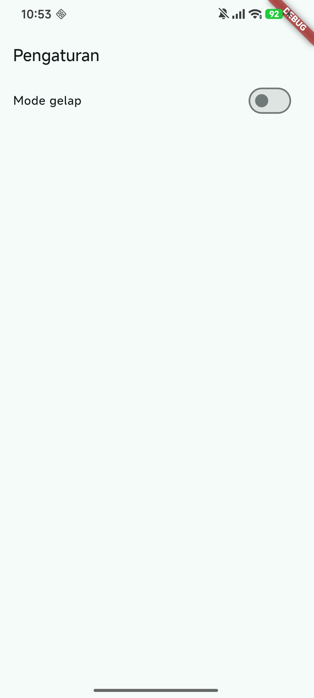 | 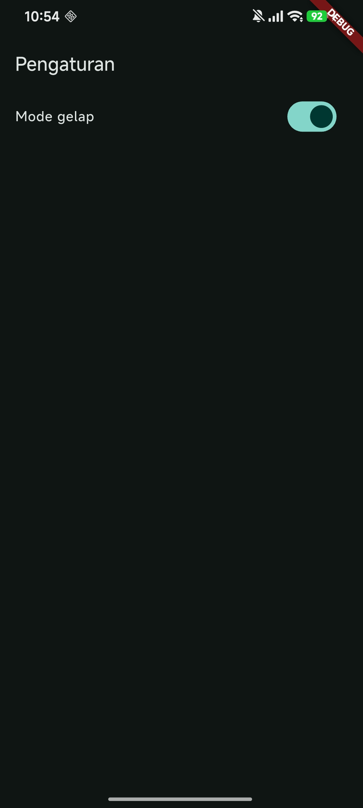 |
</blockquote>
</details>

<br>


<details>
<summary><h2>Praktikum 2: SQLite dan repository catatan</h2></summary>
<br>
<blockquote>

| Tampilan catatan kosong | Tampilan tambah catatan | Tampilan catatan keisi 1 |
|---|---|---|
| 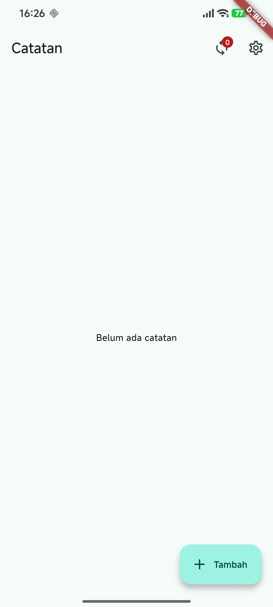 |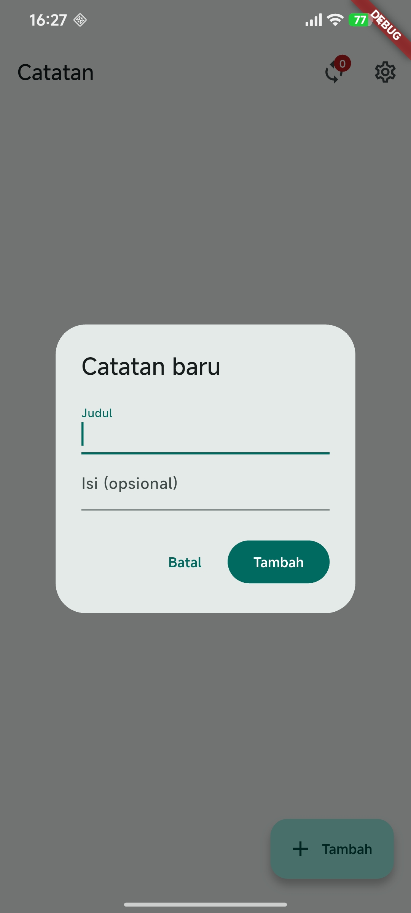 | 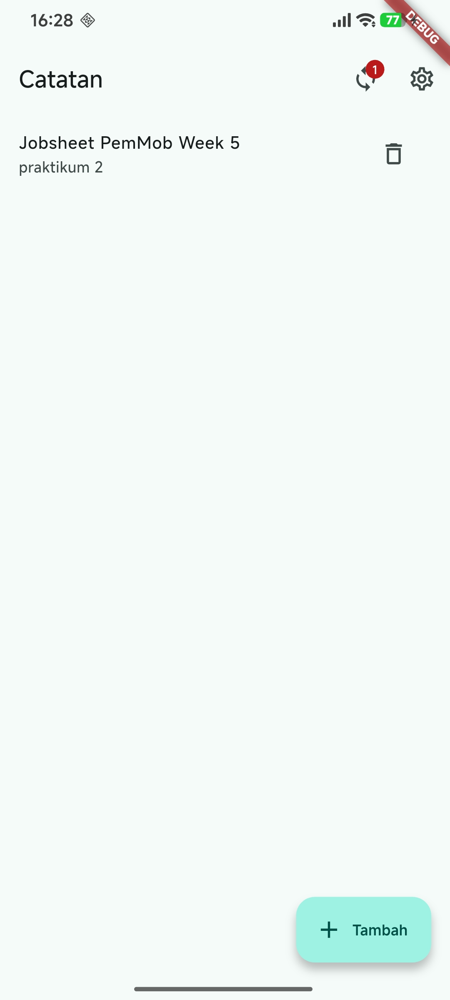
</blockquote>
</details>

<br>

<details>
<summary><h2>Praktikum 3: Cache-first dan antrean sync</h2></summary>
<br>
<blockquote>

| Tampilan run | Tampilan tersinkron | 
|---|---|
| 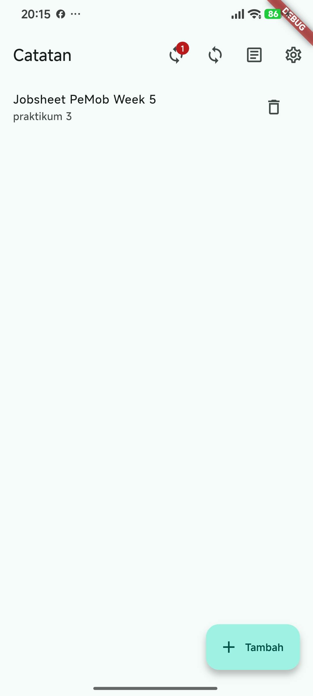 | 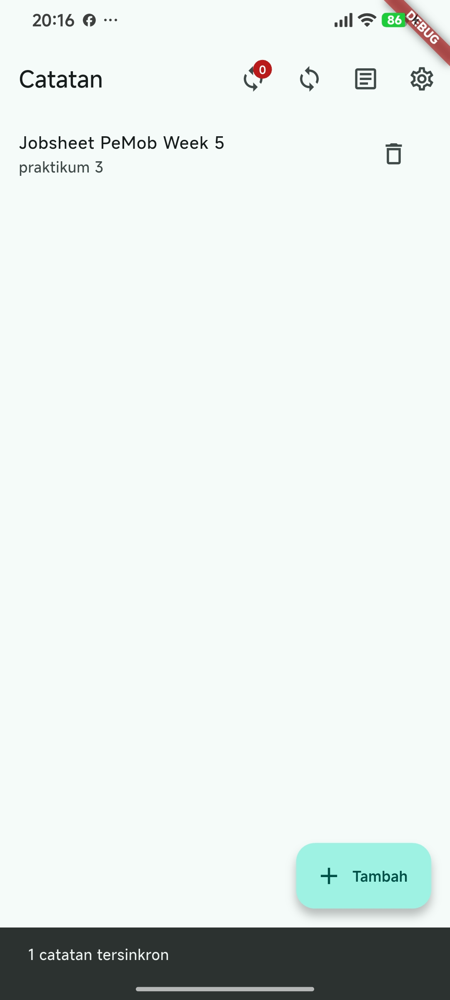 |

<br>

| Tampilan catatan saat mode pesawat | Tampilan post saat mode pesawat |
|---|---|
| 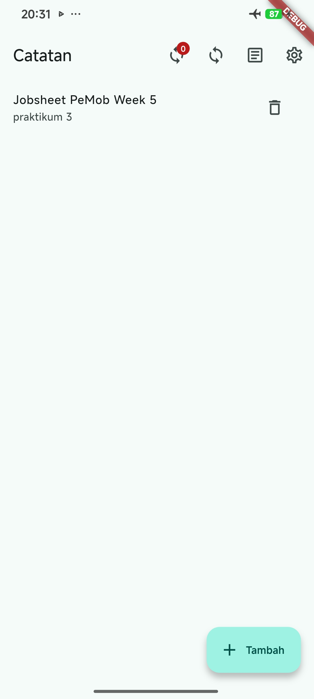 | 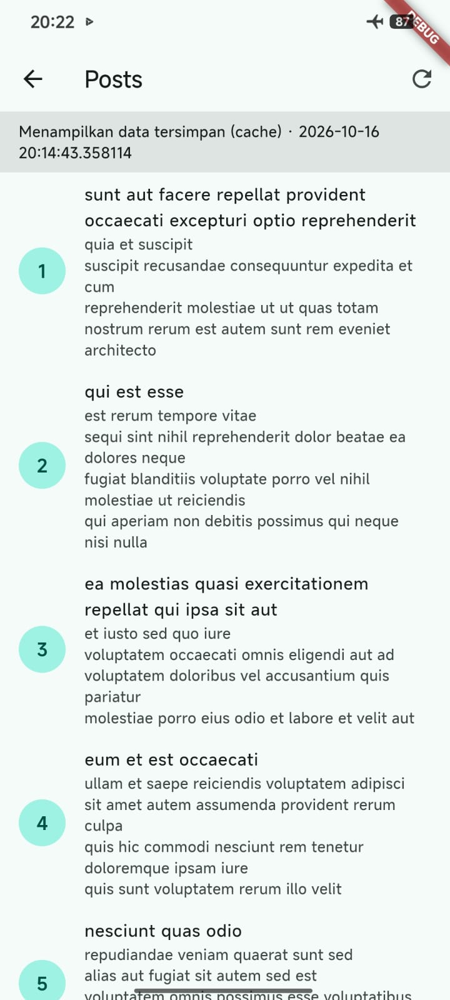 |
</blockquote>
</details>

<br>

<details>
<summary><h2>AI Challenge</h2></summary>
<br>
<blockquote>

Bagian ini membandingkan SharedPreferences, Hive, sqflite, dan Drift untuk
aplikasi Offline Notes. AI merekomendasikan SharedPreferences untuk preferensi
dan Drift untuk catatan. Keputusan akhir saya: **SharedPreferences + sqflite**,
karena kebutuhan catatan hanya CRUD dengan flag `dirty` untuk antrean sinkronisasi,
tidak memerlukan code generation, dan mudah diuji dengan repository palsu.

Temuan verifikasi singkat:
- AI tidak menaruh daftar catatan di SharedPreferences (benar).
- Skema usulan AI tidak memiliki kolom `dirty`, sehingga tidak mendukung antrean
  sinkronisasi; skema yang saya pakai menambahkannya.
- Klaim stream dan estimasi boilerplate diverifikasi lewat dokumentasi resmi dan
  percobaan instalasi Drift.

</blockquote>
</details>

<br>

<details>
<summary><h2>Refactoring, testing, dan error umum</h2></summary>
<br>
<blockquote>

## Refactoring
Refactoring sudah dijalankan pada praktikum 1,2 dan 3

## Testing
### `flutter analyze`

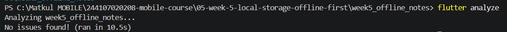

### `flutter test` — run 1,2,3

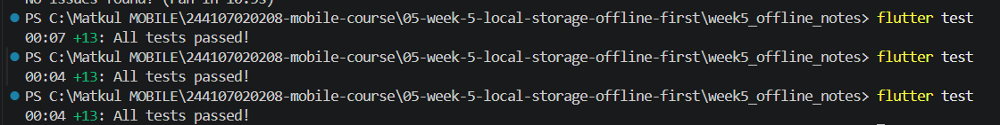

</blockquote>
</details>

<br>

<details>
<summary><h2>Tugas dan refleksi</h2></summary>
<br>
<blockquote>

## Mini Project Offline Notes

### Tujuan

Mengembangkan aplikasi Praktikum Minggu 5 agar preferensi, catatan, dan data bacaan tetap tersedia melalui penyimpanan lokal serta alur offline-first.

### Fitur utama

- Tema gelap/terang tersimpan di SharedPreferences; waktu pembukaan sebelumnya dibaca dan ditampilkan di Pengaturan, lalu waktu startup terbaru disimpan.
- Catatan persisten di SQLite melalui repository dan Riverpod: tambah, baca, edit, hapus; daftar diurutkan berdasarkan `updated_at` terbaru.
- Catatan baru atau yang diedit diberi status `dirty` dan chip **Belum sinkron**. Badge pada AppBar menunjukkan jumlah dirty; aksi sync saat ini mensimulasikan perubahan semua baris dirty menjadi bersih.
- Posts dibaca cache-first dari SQLite dan dapat diperbarui memakai endpoint JSONPlaceholder yang sudah digunakan project.

### Stack teknologi

Flutter/Dart, Riverpod, SharedPreferences, sqflite/SQLite, Dio, dan path.

### Cara menjalankan

Dari terminal PowerShell:

```powershell
Set-Location "C:\Matkul MOBILE\244107020208-mobile-course\05-week-5-local-storage-offline-first\week5_offline_notes"
flutter pub get
flutter run
```

### Hasil yang dicapai

Project mempertahankan halaman Pengaturan, daftar Posts cache-first, badge antrean sync, serta CRUD catatan dengan edit. Tes model, provider dengan fake repository, startup preference, posts cache, dan helper sync berjalan tanpa menggunakan SQLite atau HTTP sungguhan di test. Sync catatan masih simulasi lokal; tidak ada push/pull catatan ke server.

### Bukti screenshot yang akan diisi

| Bukti | File yang disiapkan untuk diisi |
|---|---|
| Daftar catatan saat mode pesawat | `screenshots/mini-project-mode-pesawat.png` |
| Catatan/badge sebelum sync | `screenshots/mini-project-sebelum-sync.png` |
| Catatan/badge setelah sync | `screenshots/mini-project-sesudah-sync.png` |

File screenshot di atas adalah lokasi yang disiapkan, bukan gambar yang sudah dibuat.

Detail aturan sinkronisasi dan keterbatasannya: [docs/konflik-sync.md](docs/konflik-sync.md). Rincian evaluasi storage: [docs/ai-challenge.md](docs/ai-challenge.md).

## Refleksi

### 1. Mengapa daftar catatan tidak boleh disimpan di SharedPreferences?

Saya memilih SQLite melalui `NoteRepository` pada `week5_offline_notes/lib/data/repositories/note_repository.dart` untuk menyimpan daftar catatan, sedangkan SharedPreferences digunakan untuk menyimpan preferensi sederhana seperti tema aplikasi. Alasannya, daftar catatan membutuhkan operasi CRUD, pengurutan berdasarkan `updated_at`, dan penandaan `dirty` untuk kebutuhan sinkronisasi.<br>

SharedPreferences lebih cocok untuk menyimpan sejumlah kecil data berbentuk key-value. Jika seluruh daftar catatan disimpan sebagai satu nilai, setiap perubahan pada daftar dapat mengharuskan aplikasi membaca, mengubah, dan menulis ulang data tersebut. Selain itu, SharedPreferences tidak menyediakan query SQL untuk mencari, mengurutkan, atau memperbarui baris tertentu.<br>

Dengan SQLite, saya dapat menambahkan, mengubah, dan menghapus catatan berdasarkan ID serta menggunakan transaksi database jika diperlukan. Oleh karena itu, SQLite lebih sesuai untuk kebutuhan penyimpanan catatan yang jumlahnya dapat mencapai lebih dari 1.000 data.

### 2. Kapan cache-first cukup, dan kapan dibutuhkan strategi lain?

Saya menggunakan strategi cache-first pada Posts melalui `PostsNotifier.build()` di `week5_offline_notes/lib/data/providers.dart`. Strategi ini memungkinkan aplikasi membaca cache terlebih dahulu agar data yang sudah tersimpan dapat ditampilkan, kemudian melakukan refresh di latar belakang ketika perangkat terhubung ke internet.<br>

Menurut saya, strategi ini cukup untuk data bacaan yang masih berguna meskipun belum sepenuhnya terbaru, terutama ketika koneksi internet lambat atau perangkat sedang offline. Namun, cache-first tidak menjamin bahwa data yang ditampilkan selalu merupakan data terbaru.<br>

Untuk informasi yang membutuhkan data terkini, seperti harga real-time, saya akan mempertimbangkan strategi network-first. Aplikasi akan mencoba mengambil data dari jaringan terlebih dahulu dan menggunakan cache sebagai alternatif jika permintaan jaringan gagal. Dengan demikian, pemilihan strategi caching perlu disesuaikan dengan kebutuhan data, toleransi terhadap data lama, dan kondisi jaringan.

### 3. Bagaimana dirty flag menjadi antrean sync tanpa memblokir UI?

Pada project saya, `addNote()` dan `updateNote()` di `week5_offline_notes/lib/data/repositories/note_repository.dart` menyimpan catatan dengan `dirty: true`. Flag tersebut menandakan bahwa catatan mengalami perubahan lokal yang belum ditandai selesai disinkronkan.<br>

Fungsi `syncNotes()` pada `week5_offline_notes/lib/data/sync.dart` menghitung catatan yang masih memiliki status dirty, kemudian menggunakan `Future.delayed` untuk menyimulasikan proses sinkronisasi. Setelah proses simulasi selesai, fungsi `markAllSynced()` mengubah status dirty menjadi `0`. Karena menggunakan penantian asynchronous, proses tersebut tidak menahan event loop UI seperti operasi sinkron yang memblokir.<br>

Namun, implementasi ini masih berupa simulasi lokal dan belum benar-benar mengirim catatan ke server. Selain itu, dirty flag hanya menunjukkan kondisi sinkronisasi suatu catatan, bukan menyimpan setiap operasi perubahan sebagai antrean terpisah.<br>

Jika aplikasi dikembangkan lebih lanjut, saya akan mempertimbangkan tabel outbox untuk mencatat operasi create, update, dan delete yang belum berhasil dikirim, termasuk status dan mekanisme retry. Dengan begitu, operasi yang belum tersinkronisasi dapat dikelola lebih terstruktur.

### 4. Bagian mana dari rekomendasi AI yang saya tolak, dan mengapa?

Dalam perbandingan yang terdokumentasi pada AI Challenge, Drift direkomendasikan sebagai pilihan penyimpanan catatan apabila prioritasnya adalah query bertipe dan pembaruan data melalui stream otomatis. Namun, untuk implementasi akhir project saya, saya memilih sqflite karena kebutuhan saat ini masih dapat dipenuhi dengan operasi CRUD, pengurutan berdasarkan `updated_at`, dan penggunaan dirty flag untuk simulasi sinkronisasi.<br>

Saya juga melakukan percobaan terpisah menggunakan Drift dan menemukan bahwa penggunaannya membutuhkan konfigurasi package tambahan serta proses code generation. Pada percobaan satu tabel sederhana, proses build memerlukan waktu sekitar 117 detik dan menghasilkan satu file `database.g.dart` berukuran 16.543 byte. Hasil ini bukan berarti Drift selalu lebih lambat, tetapi menunjukkan adanya tahapan setup tambahan pada percobaan yang saya lakukan.<br>

Saya tidak mengikuti rekomendasi penggunaan Drift untuk implementasi akhir karena manfaat query bertipe dan stream otomatis belum menjadi kebutuhan utama project saat ini. Sebagai gantinya, saya memilih sqflite yang lebih sederhana untuk kebutuhan yang ada, dengan konsekuensi bahwa pembaruan state aplikasi harus dikelola secara eksplisit.<br>

Keputusan tersebut bukan berarti Drift lebih buruk daripada sqflite. Jika aplikasi nantinya membutuhkan query yang lebih kompleks, banyak relasi, atau pembaruan data berbasis stream secara otomatis, saya akan mempertimbangkan Drift kembali. Dengan demikian, saya menggunakan rekomendasi AI sebagai bahan pertimbangan, kemudian menentukan pilihan berdasarkan kebutuhan, hasil percobaan, dan implementasi nyata project.

</blockquote>
</details>

<br>

