## NAMA  : NEVITA TRIYA YULIANA  
## KELAS : TI-3F  
## ABSEN : 20  

# Authentication, Security & FCM

<h2>Praktikum 1: Login + secure storage + token refresh</h2>

 

<blockquote>

| Tampilan login | Tampilan Login Jika Sandi < 6 | Tampilan Beranda |
|---|---|---|
|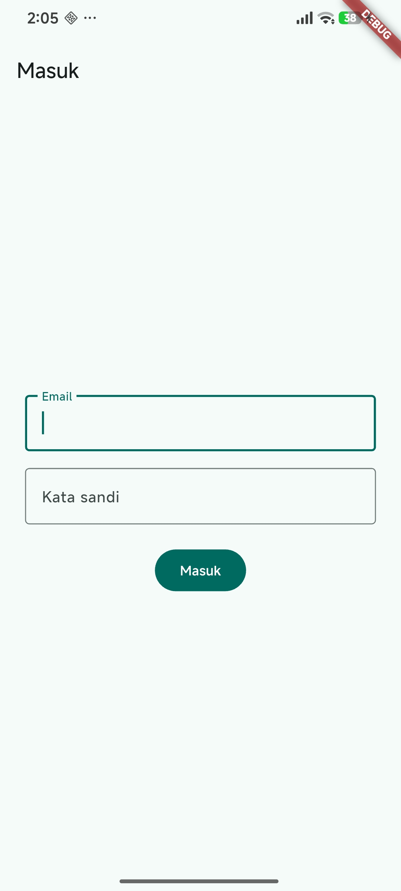 | 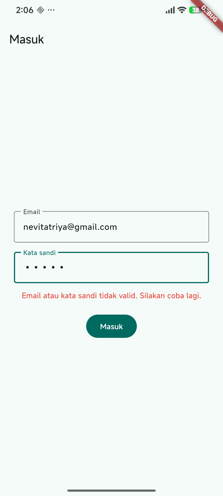 |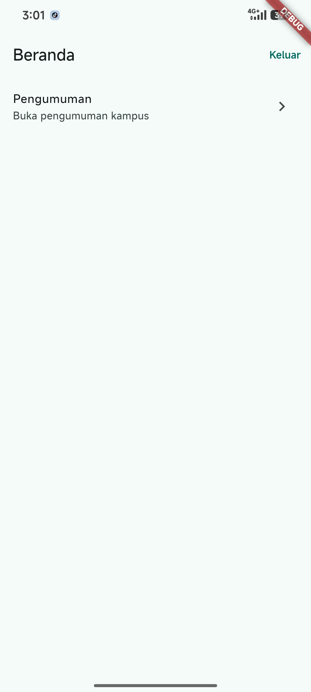 |

 

| uji token(hapus tab) | uji token(masuk lagi ke aplikasi) | uji token(load melewati login) | uji token(langsung ke beranda) |
|---|---|---|---|
|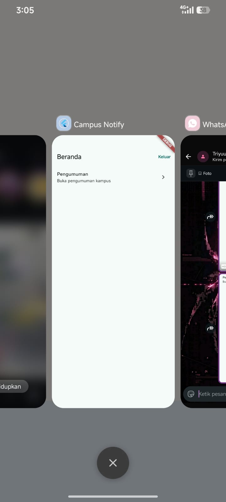 |  |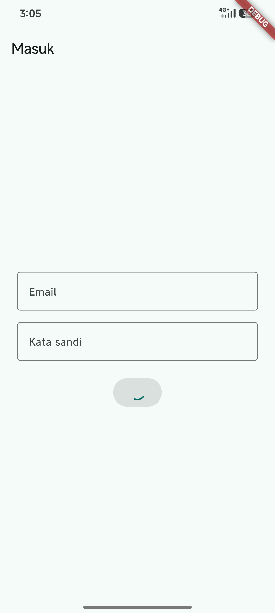 | 

</blockquote>

 

<h2>Praktikum 2: FCM, permission, dan token lifecycle</h2>

 

<blockquote>

| Tampilan debug FCM | Tampilan perizinan | Tampilan notifikasi |
|---|---|---|
|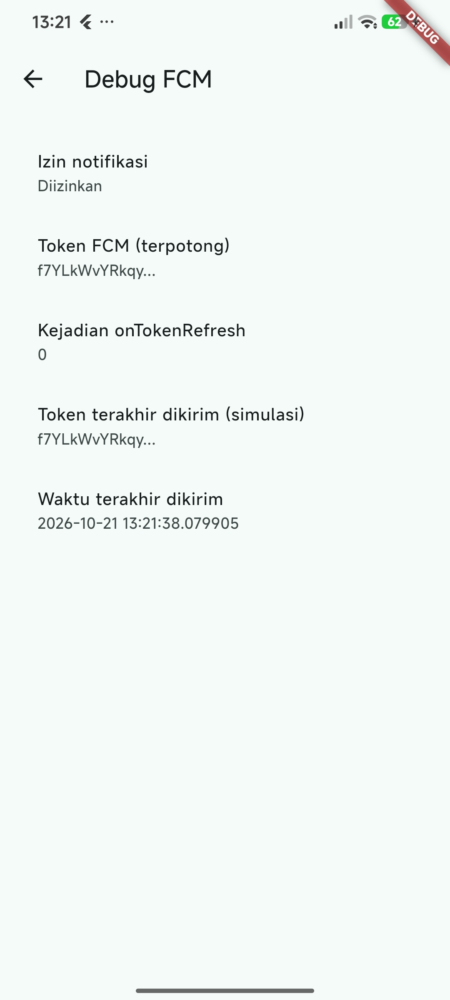 | 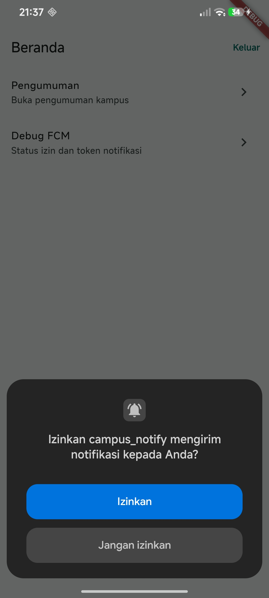 |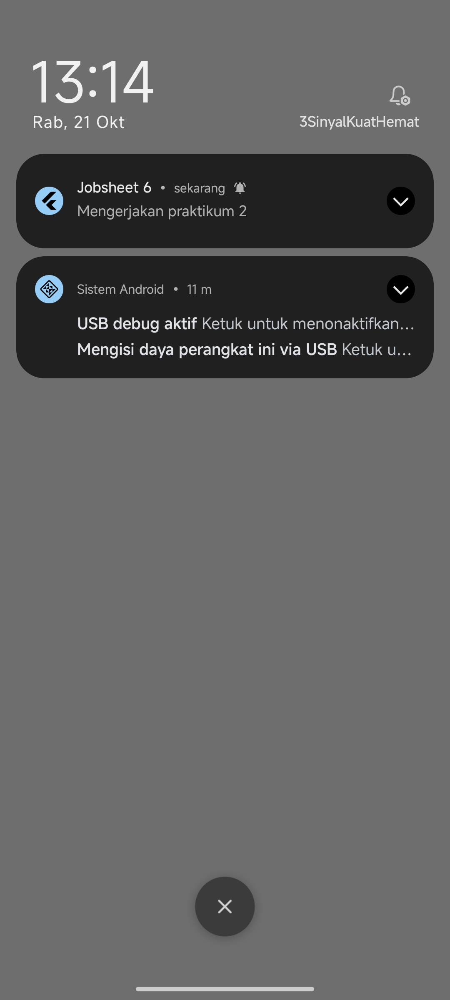 |

</blockquote>

 

<h2>Praktikum 3: Payload, tiga app state, klik dan topik</h2>

 

<blockquote>

| Tampilan Foreground | Tampilan Background  | Setelah klik notifikasi |
|---|---|---|
|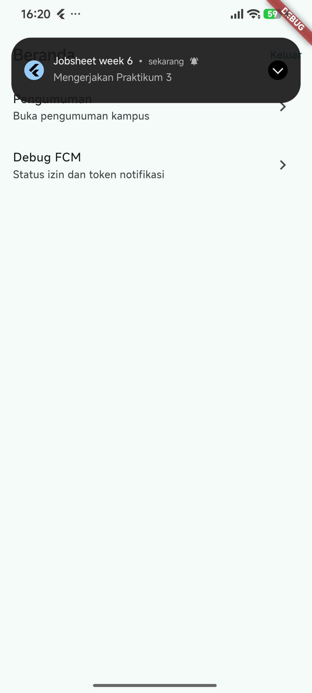 | 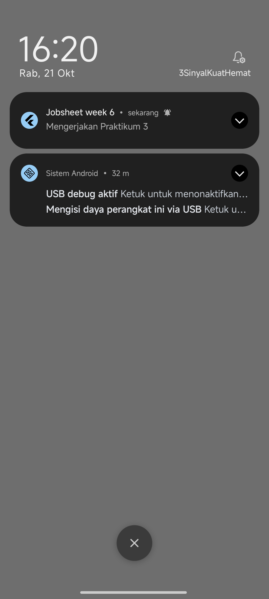 |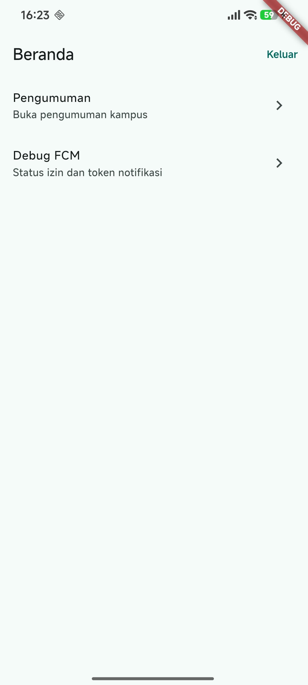 |

</blockquote>

 

<h2>AI Challenge</h2>

 

<blockquote>
Pada AI Challenge ini, AI coding assistant digunakan untuk membantu penyusunan implementasi awal fitur **Push Notification** pada aplikasi Flutter Campus Notification App menggunakan Firebase Cloud Messaging (FCM) dan `flutter_local_notifications`. 

Pengerjaan meliputi pengelolaan token FCM dan pembaruannya melalui `onTokenRefresh`, penanganan notifikasi saat aplikasi berada dalam kondisi foreground, background, dan terminated, navigasi berdasarkan payload notifikasi, serta fitur subscribe dan unsubscribe topic `pengumuman-kampus`. 

Kode yang dihasilkan AI kemudian ditinjau melalui proses verifikasi dan perbaikan manual, termasuk pemeriksaan background handler, keamanan token, validasi rute navigasi, dan perbedaan konfigurasi Android 13+ dengan iOS. 

Dokumentasi AI Challenge mencakup prompt yang digunakan, output awal AI, checklist verifikasi, daftar perbaikan manual, lifecycle token, dan tabel pengujian tiga kondisi aplikasi. Pengujian pada perangkat serta verifikasi pengiriman token ke backend produksi masih perlu dilakukan karena endpoint `/devices` pada mode debug menggunakan respons simulasi. 

Dokumentasi lengkap dapat dilihat pada folder `docs/ai-challenge.md/`.
</blockquote>

 