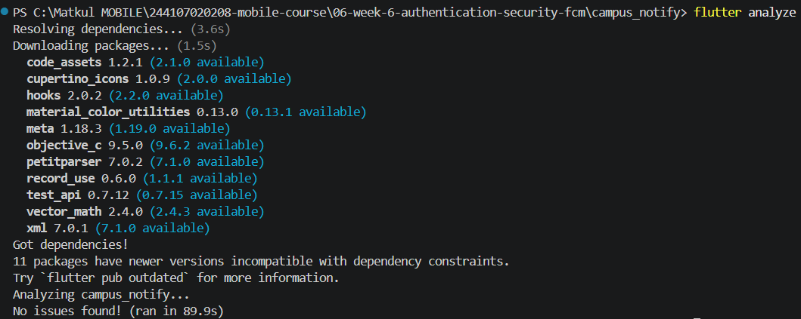
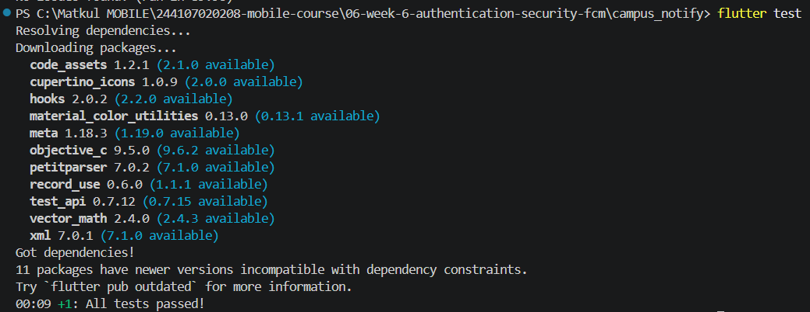

## NAMA  : NEVITA TRIYA YULIANA  
## KELAS : TI-3F  
## ABSEN : 20  

# Authentication, Security & FCM

<h2>Praktikum 1: Login + secure storage + token refresh</h2>

 
<blockquote>

| Tampilan login | Tampilan Login Jika Sandi < 6 | Tampilan Beranda |
|---|---|---|
| |  | |

 

| uji token(hapus tab) | uji token(masuk lagi ke aplikasi) | uji token(load melewati login) | uji token(langsung ke beranda) |
|---|---|---|---|
| |  | | 

</blockquote>

 

<h2>Praktikum 2: FCM, permission, dan token lifecycle</h2>

 
<blockquote>

| Tampilan debug FCM | Tampilan perizinan | Tampilan notifikasi |
|---|---|---|
| |  | |

</blockquote>

 

<h2>Praktikum 3: Payload, tiga app state, klik dan topik</h2>

 
<blockquote>

| Tampilan Foreground | Tampilan Background  | Setelah klik notifikasi |
|---|---|---|
| |  | |

</blockquote>

 

<h2>AI Challenge</h2>

 
<blockquote>
Pada AI Challenge ini, AI coding assistant digunakan untuk membantu penyusunan implementasi awal fitur **Push Notification** pada aplikasi Flutter Campus Notification App menggunakan Firebase Cloud Messaging (FCM) dan `flutter_local_notifications`. 

Pengerjaan meliputi pengelolaan token FCM dan pembaruannya melalui `onTokenRefresh`, penanganan notifikasi saat aplikasi berada dalam kondisi foreground, background, dan terminated, navigasi berdasarkan payload notifikasi, serta fitur subscribe dan unsubscribe topic `pengumuman-kampus`. 

Kode yang dihasilkan AI kemudian ditinjau melalui proses verifikasi dan perbaikan manual, termasuk pemeriksaan background handler, keamanan token, validasi rute navigasi, dan perbedaan konfigurasi Android 13+ dengan iOS. 

Dokumentasi AI Challenge mencakup prompt yang digunakan, output awal AI, checklist verifikasi, daftar perbaikan manual, lifecycle token, dan tabel pengujian tiga kondisi aplikasi. Pengujian pada perangkat serta verifikasi pengiriman token ke backend produksi masih perlu dilakukan karena endpoint `/devices` pada mode debug menggunakan respons simulasi. 

Dokumentasi lengkap dapat dilihat pada folder `docs/ai-challenge.md/`.
</blockquote>

 

<h2>Refactoring, testing, dan error umum</h2>

 
<blockquote>

| flutter analyze| flutter test  |
|---|---|
| |  |

</blockquote>

 

<h2>Refleksi</h2>

 
<blockquote>

### 1. Mengapa token FCM tidak boleh disimpan di SharedPreferences? Apa risikonya bila bocor?

`SharedPreferences` digunakan untuk menyimpan data sederhana dan bukan dirancang khusus untuk menyimpan data yang membutuhkan perlindungan lebih. Oleh karena itu, penyimpanan token yang perlu dilindungi dapat menggunakan `flutter_secure_storage`, yang memanfaatkan mekanisme penyimpanan aman pada perangkat. 

Jika token FCM bocor, pihak lain berpotensi menyalahgunakannya untuk mengirim notifikasi yang tidak diinginkan ke perangkat terkait. Namun, token FCM berbeda dari token autentikasi akun, sehingga kebocoran token FCM saja tidak otomatis memberikan akses ke akun pengguna.

### 2. Apa yang rusak bila `onTokenRefresh` diabaikan selama satu semester perkuliahan?

Jika `onTokenRefresh` diabaikan, aplikasi tidak akan memperbarui token perangkat pada backend ketika Firebase memberikan token baru. Akibatnya, backend mungkin masih menyimpan token lama sehingga notifikasi tidak dapat terkirim ke perangkat yang seharusnya menerima pesan. 

Dalam jangka waktu satu semester, masalah ini dapat menyebabkan mahasiswa melewatkan informasi penting, seperti perubahan jadwal kuliah, pengumuman ujian, dan kegiatan kampus. Oleh karena itu, aplikasi perlu mendengarkan `onTokenRefresh` dan mengirimkan token terbaru ke backend agar data perangkat tetap diperbarui.

### 3. Kapan memakai topic dan kapan memakai token perangkat? Berikan contoh pesan kampus untuk masing-masing.

**Topic** digunakan untuk mengirim notifikasi kepada banyak pengguna yang memiliki kepentingan yang sama. Contohnya, kampus mengirimkan pengumuman pembukaan pendaftaran kegiatan kepada mahasiswa yang berlangganan topic `pengumuman-kampus`. 

Sementara itu, **token perangkat** digunakan ketika notifikasi ditujukan kepada perangkat tertentu. Contohnya, aplikasi mengirimkan pemberitahuan kepada seorang mahasiswa bahwa pengajuan surat aktif kuliahnya telah selesai diproses. 

Dengan demikian, topic lebih sesuai untuk pengumuman umum, sedangkan token perangkat lebih sesuai untuk pemberitahuan yang spesifik. Untuk pesan personal, backend juga harus memastikan bahwa token tujuan terkait dengan pengguna yang berhak menerima pesan tersebut.

### 4. Bagian mana dari draf AI yang ditolak atau diperbaiki, dan mengapa?

Draf kode yang dihasilkan AI tidak langsung digunakan seluruhnya, tetapi ditinjau dan diperiksa kembali agar sesuai dengan kebutuhan aplikasi. Beberapa bagian yang menjadi perhatian dalam proses verifikasi dan perbaikan adalah: 

1. **Pengelolaan token FCM:** memastikan aplikasi mendengarkan `onTokenRefresh` dan mengirim token terbaru ke backend agar token yang tersimpan tetap diperbarui.
2. **Pengelolaan lifecycle aplikasi:** memastikan callback pembaruan token tidak bergantung pada `HomePage` atau `ref` yang mungkin sudah tidak aktif.
3. **Validasi navigasi:** memeriksa payload notifikasi sebelum digunakan untuk berpindah halaman agar aplikasi tidak diarahkan ke rute yang tidak valid.
4. **Status autentikasi:** menunda navigasi dari notifikasi ketika proses autentikasi belum selesai agar pengguna tidak diarahkan ke halaman yang belum dapat diakses.
5. **Verifikasi backend:** memastikan bahwa permintaan `POST /devices` pada mode debug masih menggunakan respons simulasi dan belum membuktikan bahwa token berhasil disimpan pada backend produksi. 

</blockquote>

 