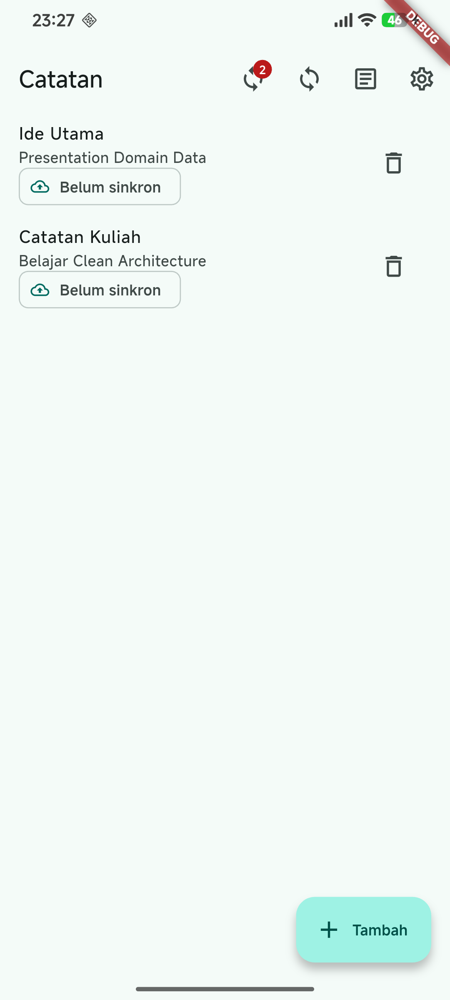
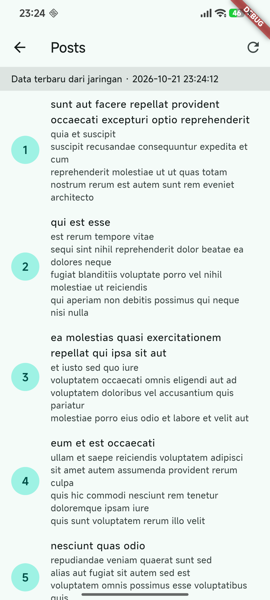

## NAMA  : NEVITA TRIYA YULIANA <br>
## KELAS : TI-3F <br>
## ABSEN : 20 <br>

# Clean Architecture feature-first

<details>
<summary><h2>Praktikum 1: Audit dan konsep arsitektur</h2></summary>
<br>
<blockquote>

### SOLID pada project Flutter

| Prinsip | Penerapan | Gejala pelanggaran |
|---|---|---|
| **S — Single Responsibility** | Page menampilkan state; repository menangani sumber data. | Widget sekaligus mengirim request, parsing JSON, dan mengatur tampilan. |
| **O — Open/Closed** | Sumber data dapat diganti di belakang kontrak repository. | Menambah sumber data mengharuskan perubahan langsung pada widget. |
| **L — Liskov Substitution** | Fake repository bisa menggantikan repository nyata sesuai kontrak. | Fake memberi perilaku/error yang berbeda dari kontrak yang diuji. |
| **I — Interface Segregation** | Notes dan Posts memiliki kontrak repository masing-masing. | Satu interface besar memaksa fitur bergantung pada operasi yang tidak dipakainya. |
| **D — Dependency Inversion** | Domain mendefinisikan kontrak; data mengimplementasikannya. | Notifier atau widget membuat Dio/SQLite secara langsung. |

### Dependency rule

```text
presentation ──> domain <── data
                  entity, contract, use case, failure
```

Domain hanya menggunakan Dart murni. Data mengetahui detail SQLite dan Dio,
lalu memenuhi kontrak domain. Presentation menggunakan kontrak melalui
provider Riverpod; widget tidak membuat repository sendiri.

### Feature-first dan layer-first

| Struktur | Bentuk | Trade-off |
|---|---|---|
| Feature-first | `features/notes/{presentation,domain,data}` | Fitur Notes dan Posts terisolasi, mudah dipahami dan dikembangkan terpisah. |
| Layer-first | `lib/{presentation,domain,data}` | Bisa sederhana untuk satu fitur kecil, tetapi file lintas fitur mudah bercampur saat aplikasi tumbuh. |

Project ini memilih feature-first karena sudah memiliki dua fitur utama,
Notes dan Posts. Detail pemetaan file Week 5 ke Week 7 tercatat di
[docs/clean-architecture.md](docs/clean-architecture.md).

</blockquote>
</details>

<br>

<details>
<summary><h2>Praktikum 2: Domain dan data per fitur</h2></summary>
<br>
<blockquote>

### Entity, model, dan repository

- **Entity** `Note` dan `Post` adalah objek bisnis di `domain`; tidak berisi
  `toMap`, `fromMap`, atau mapping JSON.
- **Model** `NoteModel` dan `PostModel` berada di `data`; model menangani
  representasi SQLite/JSON dan konversi ke entity.
- **Repository interface** `NoteRepository` dan `PostRepository` berada di
  `domain`, sedangkan implementasinya berada di `data`.
- Repository mengubah error sumber data menjadi `Failure` yang sesuai, seperti
  `LocalFailure` atau `NetworkFailure`, agar kontrak domain tidak bergantung
  pada exception package tertentu.

### Fitur yang direfactor

| Fitur | Domain | Data | Perilaku yang dipertahankan |
|---|---|---|---|
| Notes | Entity, repository contract, use case sinkronisasi dan resolusi konflik | Model dan repository SQLite | CRUD lokal, penanda dirty, status sinkronisasi, serta simulasi sync. |
| Posts | Entity, repository contract, use case refresh | Model JSON dan repository Dio/SQLite | Cache-first, refresh jaringan, dan pembacaan saat offline. |

Database opener masih dipakai bersama di `lib/data/local/db.dart`. Preferensi
tetap memakai struktur Week 5 karena tidak menjadi bagian refactor fitur ini.

### Kapan use case diperlukan?

Use case dipakai saat operasi memiliki aturan bisnis atau mengorkestrasi
beberapa langkah, misalnya sinkronisasi Notes dan refresh Posts yang melibatkan
jaringan serta cache. Operasi CRUD satu-baris tidak otomatis dibuatkan use case:
notifier boleh memanggil repository langsung sampai logika bisnisnya tumbuh.
Keputusan ini menghindari kelas dan boilerplate yang belum memberi manfaat.

</blockquote>
</details>

<br>

<details>
<summary><h2>Praktikum 3: Presentation, dependency injection, dan verifikasi</h2></summary>
<br>
<blockquote>

### Presentation dan DI

Provider Riverpod per fitur menjadi tempat wiring repository, use case, dan
state. Repository nyata dapat diganti fake melalui override provider saat test.
Halaman Notes dan Posts membaca state dari provider, bukan mengakses Dio,
SQLite, atau mapping data mentah secara langsung.

### Struktur utama

```text
lib/
├── core/
│   ├── failures.dart
│   └── format.dart
├── features/
│   ├── notes/{data,domain,presentation}/
│   └── posts/{data,domain,presentation}/
└── data/local/db.dart
```

### Pemeriksaan dependency rule

Tiga pemeriksaan menghasilkan nol temuan:

1. Tidak ada akses Dio/SQLite/secure storage/JSON mentah di presentation.
2. Tidak ada import Flutter atau driver/package data di domain dan core.
3. Tidak ada mapping map/JSON pada entity dan repository contract domain.

Helper format tanggal dan parsing route berada di `lib/core/format.dart` dan
diuji sebagai fungsi Dart murni. Rincian perintah dan hasil ada di
[docs/verification.md](docs/verification.md).

### Cara menjalankan

Jalankan dari PowerShell:

```powershell
Set-Location "C:\Matkul MOBILE\244107020208-mobile-course\07-week-7-clean-architecture"
flutter pub get
flutter analyze
flutter test
flutter run -d <android-device-id>
```

Runner Android dan Windows tersedia. Web masih berupa scaffold; penyimpanan
SQLite aplikasi belum didukung di web. Build Windows membutuhkan Visual Studio
dengan workload **Desktop development with C++**.

### Hasil validasi

- `flutter analyze`: **No issues found**.
- `flutter test`: **22 test lulus**, termasuk use case sukses/failure, fake
  repository, perilaku cache/offline, sinkronisasi, dan helper format.
- `flutter build apk`: berhasil.
- Domain/use case diuji tanpa database SQLite atau request HTTP sungguhan.

### Screenshot dari HP fisik

Screenshot hasil Week 7 diambil langsung dari HP Android fisik (Android 16,
1080 × 2400), bukan dari Chrome:

| Halaman Notes | Halaman Posts |
|---|---|
|  |  |

Screenshot Notes berisi dua catatan contoh lokal dengan status belum sinkron;
Posts menampilkan data yang berhasil dimuat dari jaringan. Banner DEBUG tampak
karena aplikasi dijalankan dengan `flutter run`. Screenshot baseline Week 5
(`run1.png`–`run9.png`) juga tetap tersedia di folder ini sebagai pembanding.

</blockquote>
</details>

<br>

<details>
<summary><h2>AI Challenge</h2></summary>
<br>
<blockquote>

### Prompt

```text
Project Flutter saya adalah aplikasi Week 5 Offline Notes dengan CRUD catatan
SQLite, preferensi SharedPreferences, dan Posts cache-first dengan Dio.
Kondisi awal: model catatan masih memuat mapping SQLite, repository catatan
mencampur implementasi dengan provider, dan Posts memiliki model/repository
serta provider di folder data.

Tugas:
1. Usulkan struktur feature-first Clean Architecture untuk Notes dan Posts.
2. Petakan setiap file lama ke tujuan baru (pindah, pecah, atau tetap).
3. Jelaskan bagian yang over-engineering untuk CRUD sederhana dan kapan use
   case diperlukan dibanding repository langsung.
4. Tunjukkan wiring dependency injection dengan Riverpod tanpa package DI baru.
5. Jelaskan trade-off, error/failure, arah dependency, serta pengujian use case
   dengan repository palsu tanpa SQLite atau jaringan.
Jangan menambah fitur bisnis baru dan jangan mengubah folder project Week 5.
```

### Ringkasan usulan AI dan keputusan final

| Area | Usulan awal AI | Keputusan final dan alasan |
|---|---|---|
| Struktur | Pisahkan Notes dan Posts secara feature-first. | Diterapkan sebagai `features/{notes,posts}/{presentation,domain,data}` karena dua fitur sudah ada dan batas tugas tidak meminta fitur bisnis baru. |
| Entity/model | Pisahkan entity murni dari model penyimpanan/jaringan. | Diterapkan; mapping SQLite/JSON berada di model data supaya domain tidak mengetahui format luar. |
| Repository | Kontrak di domain dan implementasi di data. | Diterapkan untuk `NoteRepository`/`PostRepository`; arah dependency tidak membuat domain bergantung pada Dio atau SQLite. |
| Use case | Gunakan untuk operasi bisnis dan orkestrasi. | `GetNotes`, sinkronisasi Notes, dan refresh Posts dipisah; operasi CRUD sederhana tetap langsung melalui repository agar tidak menambah boilerplate. |
| DI | Riverpod tanpa library DI baru. | Diterapkan melalui provider tiap fitur, yang juga dapat dioverride dengan fake saat test. |
| Shared database | Gunakan database opener bersama. | `lib/data/local/db.dart` tetap menjadi helper lintas fitur; pemisahan penuh belum diperlukan untuk dua fitur yang menggunakan database aplikasi yang sama. |
| Navigasi | Hindari mengganti router tanpa kebutuhan. | Alur Navigator yang sudah ada dipertahankan; helper parsing route murni diekstrak dan diuji. |
| Cakupan | Refactor kode yang sudah ada. | Notes dan Posts direfactor; preferensi dibiarkan pada struktur lama karena bukan fokus fitur ini. |

### Checklist evaluasi hasil AI

- Kontrak repository berada di domain, implementasi berada di data: **terpenuhi**.
- Domain bebas import Flutter, Dio, SQLite, Firebase, dan mapping data: **terverifikasi dengan pencarian kode**.
- Use case satu-baris untuk setiap operasi CRUD: **tidak dibuat**; orkestrasi yang punya tanggung jawab bisnis dipisahkan, sedangkan CRUD sederhana tetap langsung.
- Entity bebas `toMap/fromMap/toJson/fromJson`: **terpenuhi**.
- Wiring DI menggunakan provider dan widget tidak membuat repository: **terpenuhi**.
- Week 5 tidak diubah oleh deliverable Week 7: **terpenuhi**.

Prompt, output AI awal, dan tabel keputusan ini juga tersedia di
[docs/ai-challenge.md](docs/ai-challenge.md). Pemetaan file lengkap dan
trade-off implementasi ada di [docs/clean-architecture.md](docs/clean-architecture.md).

</blockquote>
</details>

<br>

<details>
<summary><h2>Refactoring, testing, dan batasan</h2></summary>
<br>
<blockquote>

### Refactoring yang dilakukan

1. Memisahkan Notes dan Posts ke feature folder dengan layer data, domain, dan
   presentation.
2. Memindahkan entity dan kontrak repository ke domain, lalu meletakkan model
   serta implementasi SQLite/Dio di data.
3. Memusatkan wiring repository/use case/state pada provider Riverpod.
4. Mengekstrak formatting tanggal dan parsing route ke helper Dart murni.
5. Menambahkan test berbasis fake agar use case dapat diuji tanpa plugin
   database atau jaringan sungguhan.

### Hasil testing

`flutter test` menjalankan 22 test dan seluruhnya lulus. Fake repository
memastikan use case meneruskan data sukses maupun `Failure` tanpa mengharuskan
test membuka SQLite atau memanggil API. Cache-first/offline, sinkronisasi, dan
helper format juga tercakup.

### Batasan yang diketahui

- Sinkronisasi catatan pada project ini masih simulasi lokal; tidak ada
  pengiriman catatan ke backend.
- Preferensi belum dimigrasikan ke struktur feature-first.
- Web runner tersedia sebagai scaffold, tetapi fitur SQLite belum didukung
  pada target web.
- Screenshot Notes menunjukkan catatan lokal yang belum sinkron; screenshot
  Posts menunjukkan data jaringan pada saat pengambilan screenshot.

</blockquote>
</details>

<br>

<details>
<summary><h2>Refleksi</h2></summary>
<br>
<blockquote>

### 1. Mengapa interface repository berada di domain, bukan di data?

Domain menentukan data dan operasi yang dibutuhkan oleh aturan bisnis, sehingga
kontrak repository merupakan bagian dari kebutuhan domain. Layer data kemudian
menerapkan kontrak itu dengan SQLite, Dio, atau sumber lain. Jika interface
berada di data, domain harus mengetahui atau mengimpor layer yang seharusnya
menjadi detail implementasi. Arah dependency pun terbalik dan pengujian domain
lebih sulit dipisahkan dari teknologi penyimpanan.

### 2. Kapan use case dibutuhkan, dan kapan repository langsung ke notifier cukup?

Use case bermanfaat saat sebuah operasi memiliki aturan bisnis, validasi, atau
mengorkestrasi lebih dari satu operasi/sumber data. Contohnya sinkronisasi Notes
yang menghitung data dirty dan mengubah statusnya, serta refresh Posts yang
mengambil data lalu memperbarui cache. Untuk operasi CRUD sederhana yang hanya
meneruskan pemanggilan repository, notifier dapat memanggil repository langsung.

### 3. Apa biaya over-engineering use case per CRUD satu-baris?

Setiap abstraksi tambahan menambah file, navigasi kode, boilerplate, dan hal
yang perlu dipahami serta dipelihara. Pada tim kecil atau fitur CRUD sederhana,
biaya itu dapat lebih besar daripada manfaat isolasinya. Use case menjadi
sepadan ketika aturan bisnis mulai berkembang, dipakai ulang, atau perlu
diuji/dikelola sebagai operasi mandiri.

### 4. Bagian mana dari usulan AI yang disederhanakan, dan mengapa?

Usulan untuk membuat use case bagi setiap operasi CRUD tidak diterapkan. Operasi
yang hanya meneruskan parameter ke repository dibiarkan langsung dipanggil dari
notifier agar lapisan tambahan tidak menjadi boilerplate. Use case dipertahankan
untuk operasi yang memang mengorkestrasi sinkronisasi atau refresh. Selain itu,
router tidak diganti dan preferensi belum dimigrasikan, karena perubahan itu
tidak diperlukan untuk memenuhi tujuan refactor Notes dan Posts. Keputusan ini
mempertahankan perilaku aplikasi dan membatasi risiko perubahan di luar scope.

</blockquote>
</details>
